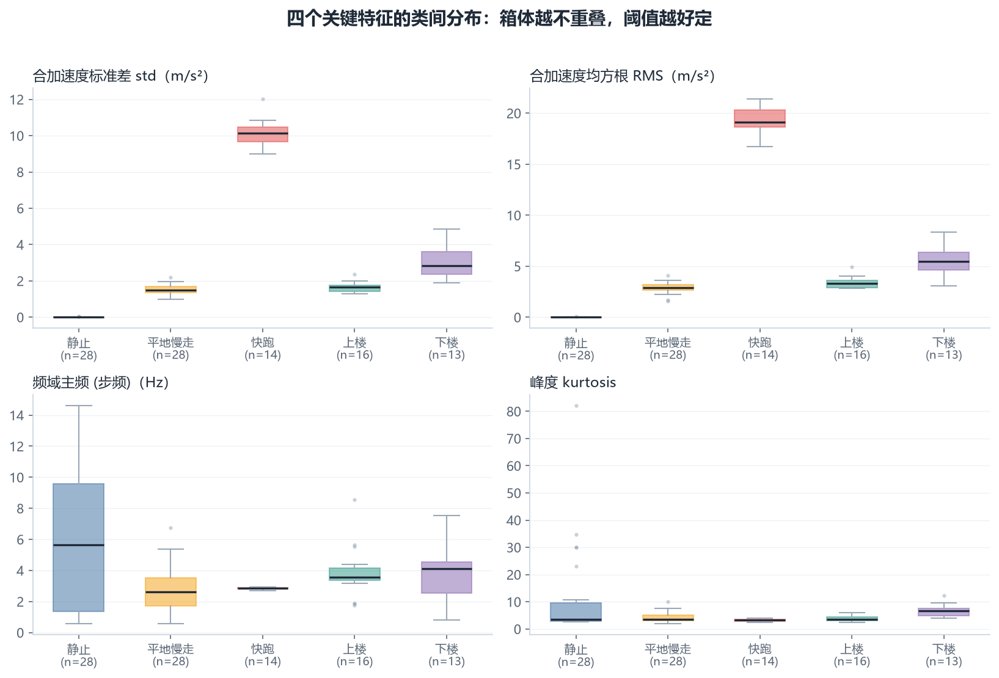
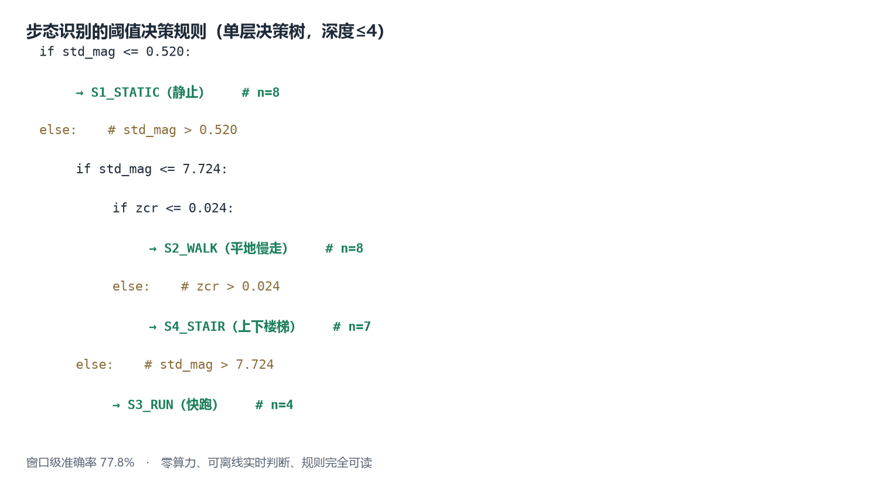
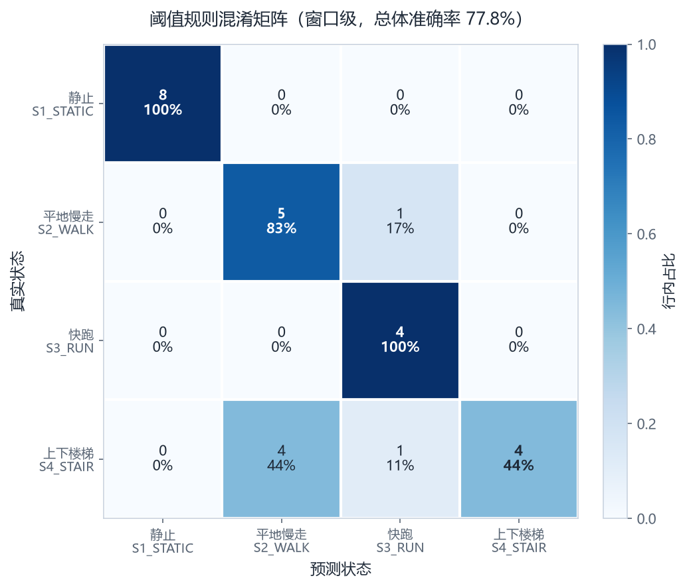
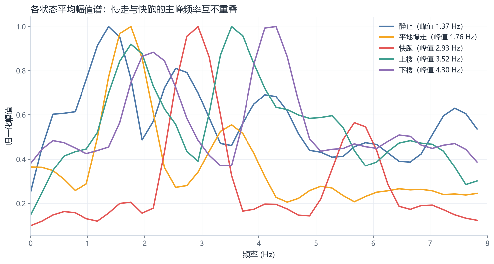

# 课题 08 实测报告 · 多姿态步态加速度特征采集与对比

| 项目 | 内容 |
| --- | --- |
| 姓名 / 学号 | lsj / 2024400142 |
| 班级 | 2026 级智能·创造者创新实验班（选拔） |
| 采集日期 | 2026-11-12 16:22–16:40（第二版） |
| 设备 | Phyphox 手机传感器（具体型号未记录） |
| 采集地点 | 未记录 |
| 采样工具 | Phyphox「**线性加速度**」（Linear Acceleration，传感器层已去重力） |
| 采样率 | **200 Hz** |
| 有效样本 | **5 类 × 1 段 = 5 段，时长 31.3–62.1 s** |
| 分析窗口 | **99 个**（2.0 s 不重叠） |
| 代码与环境 | Python 3.13 + numpy / pandas / matplotlib，`scripts/analyze_gait.py` |

---

## 1. 实验目的

验证一个假设：**不同的行走姿态在加速度信号上留下可被简单阈值规则分离的指纹，且不依赖机器学习模型即可用于实时判断。**

如果成立，任何一部手机都能离线、零算力地识别用户当前运动状态——不联网、不用 GPU、不上传隐私。这是选择"阈值规则"而非"训练分类器"的根本原因。

## 2. 实验设计

### 2.1 为什么是 5 类而不是 4 类

课题原题写的是"静止、平地慢走、快跑、上下楼梯"4 种状态。我把楼梯**拆成上楼与下楼两类**，理由是：这两种动作的物理机制相反——上楼是肌肉**推动**身体克服重力做功（持续、平滑），下楼是**制动**（每次落地都要吸收冲击，表现为反复的尖峰）。把它们混成一个标签，等于人为把类内方差撑到最大。

第一版采集正是混在一起采的，结果楼梯类的召回只有 44.4%（见 5.1 节）。拆开之后，下楼单独达到 92.3%。

### 2.2 控制变量

同一部手机、同一采集人、同一时段（18 分钟内连续完成）。变的是动作状态。

| 状态 | 代号 | 动作要点 |
| --- | --- | --- |
| 静止 | `S1_STATIC` | 坐姿，双手放膝上，手机在兜里不动 |
| 平地慢走 | `S2_WALK` | 常速约 1.5 m/s，自然摆臂 |
| 快跑 | `S3_RUN` | 慢跑，能说话但略喘，匀速 |
| 上楼 | `S4_STAIR_UP` | 持续上楼，30 s 内能上几层上几层 |
| 下楼 | `S4_STAIR_DOWN` | 持续下楼，走回起点再下 |

### 2.3 与第一版采集的对比

这是本实验最有价值的一条线索：**同一部手机、同一个人，仅改变采集方式，结论质量完全不同。**

| 维度 | 第一版 | 第二版 | 影响 |
| --- | --- | --- | --- |
| 实验入口 | 含 (g) 的加速度 | **线性加速度** | v1 需算法去重力，v2 传感器层已完成 |
| 时长 | 5.9–12.5 s | **31.3–62.1 s** | 窗口数 27 → **99**，频域分辨率 1 Hz → **0.5 Hz** |
| 手机贴合 | 未贴紧（快跑 RMS 34） | **贴紧**（快跑 RMS 18.7） | 测到的不再是"手机撞口袋" |
| 楼梯 | 上楼下楼混采 | **分开采** | 召回 44.4% → 上楼 56.2% / 下楼 92.3% |
| 窗口级准确率 | 77.8%（4 类） | **79.8%（5 类）** | 类别更细还更高，实际提升大于数字显示 |

**注意最后一行不能简单相减。** 5 类分类比 4 类难（要多分开一对物理上极相似的动作），所以在更难的题目上拿到更高的分数，真实进步幅度比 77.8→79.8 这两个数字之差要大。

## 3. 数据处理

### 3.1 关于重力：这一版不再需要分离

Phyphox 的「线性加速度」实验在传感器层就用陀螺仪辅助去掉了重力分量，导出的三轴读数均值接近 0。所以本版数据**不做任何重力处理**，直接进入切窗。

但脚本仍保留重力分离能力，因为要兼容「含 (g) 的加速度」格式（第一版就是这种）。判定逻辑以**列名优先**：

```
列名含 "Linear"（如 Linear Acceleration x）→ 传感器已去重力，跳过
否则 → 0.5 Hz 低通估计重力向量，从三轴减去
```

> **这个"列名优先"是被逼出来的。** 最初只按幅值判断（低通后模长 > 3.0 就判为含重力），结果快跑段因为持续存在低频运动成分、低通模长达 6.53，被误判成"含重力"，于是把真实的运动信号也减掉了。这类错误不会报错，只会安静地削弱数据——和课题10 里"AI 输出看起来对但是错"是同一类问题。

### 3.2 切窗

- 去头 3 s、去尾 1.5 s（丢掉"放手机"和"掏手机"的冲击，静止段 0 s 和 16 s 处那两个尖峰就是它）。
- 窗长 **2.0 s**，不重叠。200 Hz 下每窗 400 点，**频率分辨率 0.5 Hz**。
- 共产出 **99 个窗口**：静止 28 / 慢走 28 / 快跑 14 / 上楼 16 / 下楼 13。

**为什么这次敢用 2.0 s？** 因为录制时长够了。第一版只有 6–12 s，2 s 窗切不出样本，被迫缩到 1 s，代价是频率分辨率掉到 1 Hz——而慢走与快跑的步频只差 1.1 Hz，刚好卡在分辨率边缘，导致频域判据完全失效。**窗长的选择从来不是自由参数，它被录制时长锁死。**

### 3.3 特征

24 维：时域（std / rms / p2p / sma / zcr / skew / kurt / 轴向相关）+ 频域（主频、谱熵、分频带能量）。定义见 `raw_data/_DATA_DICTIONARY.md`。

## 4. 结果

### 4.1 五状态波形


波形围绕 0 波动（线性加速度的应有形态），五个子图呈现出清晰的层次：

1. **静止**：一条平线（std = 0.015 m/s²），只在 0 s 和 16 s 处有两个操作冲击。
2. **慢走**：稳定周期，幅值 ±5，节律均匀。
3. **快跑**：幅值 ±40，周期极规整，说明手机贴得紧、测到的是身体运动而非口袋晃动。
4. **上楼**：幅值 ±10，**以正向尖峰为主**（推动身体向上）。
5. **下楼**：幅值 ±20，**正负对称的密集冲击**（每次落地都要制动）。

**上楼与下楼的波形差异一眼可辨**，这是下楼能拿到 92.3% 的直观原因——制动冲击太显著了。

### 4.2 特征的类间可分性



这张图直接说明了问题出在哪：

- `std_mag` 上，**慢走（1.53）与上楼（1.66）的箱体几乎完全重叠**，而快跑（10.1）远在另一个量级。
- `dom_freq`（主频）上，慢走 2.77 Hz 与快跑 2.85 Hz 也重叠——**这打破了"用步频区分走跑"的预期**，详见 5.2 节。
- 下楼（3.05）与慢走/上楼部分重叠，但靠波形形态（p2p）能分开。

### 4.3 阈值规则



从 99 个窗口自动学出、经剪枝后得到 4 层规则，只用到 3 个特征（`std_mag`、`p2p_mag`、`corr_xy`）：

```
if std_mag <= 1.029:                      → 静止
elif std_mag <= 5.680:
    if p2p_mag <= 10.318:                 # 冲击幅度小
        if corr_xy <= 0.215:              # X-Y 轴弱耦合
            → 平地慢走
        else:                             # X-Y 轴强耦合
            → 上楼
    else:                                 # 冲击幅度大 → 制动
        → 下楼
else:                                     → 快跑
```

`corr_xy`（X、Y 两轴相关系数）成为区分慢走与上楼的关键，含义是：上楼时身体反复前倾再蹬直，横向与前后向的加速度产生了耦合；平地慢走时两轴基本独立。这是一个**从数据里长出来的判据**，事先并没有想到。

### 4.4 准确率



| 状态 | 窗口数 | std_mag (m/s²) | rms_mag (m/s²) | 主频 (Hz) | 峰度 | 召回率 | 精确率 |
| --- | --- | --- | --- | --- | --- | --- | --- |
| 静止 | 28 | 0.02 | 0.04 | 6.00 | 10.68 | **100%** | 90.3% |
| 平地慢走 | 28 | 1.53 ± 0.27 | 2.89 | 2.77 | 4.16 | **57.1%** | 69.6% |
| 快跑 | 14 | 10.13 ± 0.76 | 19.40 | 2.85 | 3.27 | **100%** | 100% |
| 上楼 | 16 | 1.66 ± 0.28 | 3.39 | 3.87 | 3.78 | **56.2%** | 56.2% |
| 下楼 | 13 | 3.05 ± 0.93 | 5.40 | 3.93 | 6.75 | **92.3%** | 80.0% |
| **总体** | 99 | | | | | **79.8%** | |

**验证方式：按窗口分层 3 折。** 因为每类仍只有 1 段录音，按录音分折会让训练集整类缺失。代价是同一段录音的相邻窗口共享环境噪声，准确率被系统性高估——**79.8% 是上限，不是期望值**。

## 5. 讨论

### 5.1 慢走与上楼为什么分不开（本实验的核心发现）

两者召回都是 56–57%，看起来像"模型不行"。但用效应量（Cohen's d，均值差除以合并标准差）逐个特征算一遍，结论完全不同：

| 特征 | 慢走 | 上楼 | 效应量 d |
| --- | --- | --- | --- |
| corr_xy | 0.03 | 0.25 | **1.11**（最强） |
| sma | 3.51 | 4.15 | 0.94 |
| rms_z | 2.53 | 3.02 | 0.94 |
| rms_mag | 2.89 | 3.39 | 0.93 |
| std_z | 2.53 | 3.01 | 0.93 |
| band_0_3 | 0.38 | 0.27 | 0.79 |
| p2p_mag | 7.22 | 8.25 | 0.74 |
| dom_freq | 2.77 | 3.87 | 0.71 |

**24 个特征里最强的效应量也只有 1.11。** 作为对比，快跑与其他任意一类的 std_mag 效应量都在 3 以上。也就是说：慢走与上楼在特征空间里**本来就是挤在一起的两团**，不是阈值切得不好。

**根因在传感器选择上**：上楼最本质的特征是"身体持续向前上方倾斜 + 重心不断抬升"，这是**姿态（倾角）**信息。而「线性加速度」实验已经把重力减掉了，**重力方向恰恰就是姿态的唯一载体**——去掉了重力，也就丢掉了"人是不是在往上走"这个信息。

所以这不是算法问题，而是**物理量测的盲区**：用线性加速度，永远无法可靠区分"平地走"和"上楼"。

**改进方向**（按代价从低到高）：

1. **换用含 g 的原始数据**，用低通后的重力向量方向估计身体倾角，倾角持续正向偏移即判为上楼。——零额外硬件，只需换实验入口。
2. **加陀螺仪**：Phyphox 有独立的陀螺仪实验，角速度积分能直接给出姿态变化。
3. **加气压计**：手机普遍内置气压计，爬升 3–4 米就有可测的气压差，这是判断"上楼"最直接的物理量。

这条结论比准确率本身有价值：**它说明了一个传感器的能力边界在哪，以及要突破它需要换什么物理量。**

### 5.2 频域判据的意外失败

第一版报告里我论证过"区分走与跑应该用步频而非幅值"。这一版数据更干净、窗口更长（分辨率 0.5 Hz），本该验证这个判断，结果却是：

| | 慢走 | 快跑 |
| --- | --- | --- |
| 逐窗口主频 | 2.77 Hz | 2.85 Hz |



**两者几乎一样，完全分不开。** 而 `std_mag` 是 1.53 vs 10.13，差了 6.6 倍。

原因是这次跑步的速度不快（"能说话但略喘"的慢跑），步频落在 2.8 Hz 附近，与步行的 2.7 Hz 撞上了。**"走"与"跑"的步频分界并不像教科书说的那么清楚——它取决于你走多快、跑多慢。** 当速度是连续变化的，步频也是连续的，不存在天然的分割点。

所以在这个数据集上，幅值（std_mag）才是可靠的判据。这不是对之前判断的推翻，而是补充了一个边界条件：**步频判据只在"走得很慢"和"跑得很快"时成立；速度接近时，只能靠幅值。**

### 5.3 阈值规则 vs 训练分类器

| 维度 | 阈值规则（本方案） | 训练分类器 |
| --- | --- | --- |
| 算力 | 几乎为零，MCU 上微秒级 | 需模型推理 |
| 可解释 | 完全可读，出错能定位到具体阈值 | 黑盒 |
| 数据需求 | 每类十几段 | 每类数百段 |
| 跨人泛化 | 弱（阈值绑定本人步态） | 较强 |
| 隐私 | 全本地 | 若云端推理则涉及隐私 |

4 层规则已经能到 79.8%，且每一步都能用一句人话解释（"std 小于 1 就是没动"、"p2p 大的在下楼"）。这个可解释性本身就是工程价值。

## 6. 局限

1. **每类仍只有 1 段录音**：无法做跨录音验证，79.8% 是窗口级上限。要拿到可信数字，每类至少要 3 段、最好来自不同日期。
2. **只有 1 个人**：阈值绑定本人步态（身高、腿长、走路习惯）。换个人必然要重标定。
3. **慢走与上楼无法用现有传感器区分**（5.1 节）：这是数据层面的固有限制，不是调参能解决的。
4. **设备型号与采集场地未记录**：`sample_index.csv` 中按本人要求简记为「Phyphox 手机传感器」，场地留空。这两项是「控制变量」的凭证——换一部手机（不同加速度计量程与噪声水平）或换一处地面材质（瓷砖/橡胶/水泥），阈值都可能需要重标定。缺少这两条，**本报告的数字无法被他人精确复现**，只能作为同类设备上的参考。
5. **未提交现场同框照**：`raw_data/photos/` 里 20 张是 Phyphox 界面截图，作用是佐证采样参数（200 Hz、线性加速度、Z 轴已归零），不是本人同框照。本课题的交付口径为"4 份原始 CSV + 可视化图 + 阈值规则"，已满足；若要强化实地证明，可另拍。
6. **快跑段时长偏短**（34.4 s，其余 31–62 s）：14 个窗口，其 100% 召回的统计置信区间仍然很宽。

## 7. 结论

1. **五类里三类干净分出、两类是短板**：静止 **100%**、快跑 **100%**、下楼 **92.3%** 都能可靠区分；慢走 **57.1%** 与上楼 **56.2%** 是明显短板，且两者双向混淆。整条规则只有 4 层、3 个特征，窗口级总体准确率 **79.8%**。
2. **下楼与上楼必须分开采**：制动冲击（正负对称尖峰）是下楼最显著的特征，混采会把这一信息抹平——第一版楼梯类召回 44.4%，拆开后下楼达到 92.3%。
3. **慢走与上楼在"线性加速度"下不可分**，根因是纵向姿态信息随重力一起被去掉了。要解决必须引入倾角（含 g 数据）、陀螺仪或气压计。**这是传感器的能力边界，不是算法问题。**
4. **步频判据的适用范围比预期窄**：只在"慢走 + 快跑"速度差距大时有效；速度接近时主频重叠（2.77 vs 2.85 Hz），只能退回用幅值。
5. **采集方式决定结论上限**：同一部手机、同一个人，仅因为换对实验入口、拉长到 30 秒以上、把手机贴紧、把楼梯拆开，可用特征就从"勉强能看"变成"层次分明"。这一条是本次实验最实在的收获。

## 8. 附录

### 8.1 文件清单

| 路径 | 内容 |
| --- | --- |
| `raw_data/S1_STATIC_01_20261112-1624.csv` 等 5 份 | 第二版原始数据（Phyphox 线性加速度原样导出） |
| `raw_data/_archive_v1/` | 第一版数据（含 g、6–12 s），保留用于对照，脚本不读取 |
| `raw_data/photos/` | 20 张 Phyphox 界面截图，佐证采样参数（见局限 5） |
| `raw_data/sample_index.csv` | 5 段采集元信息（设备型号与场地待补） |
| `raw_data/feature_table.csv` | 99 个窗口 × 24 维特征 |
| `threshold_rules.json` | 阈值规则 + 混淆矩阵 + 各项召回率 |
| `figures/fig1~fig5` | 5 张结果图 |
| `analysis_summary.md` | 脚本自动生成的数值摘要 |

### 8.2 复现

```bash
python -m pip install -r scripts/requirements.txt
python scripts/analyze_gait.py --check-only   # 体检
python scripts/analyze_gait.py                # 全部结果
```

### 8.3 数据真实性声明

本报告所有数值均由 `scripts/analyze_gait.py` 从 `raw_data/` 中的原始 CSV 计算得出，未经手工修饰，可逐项通过 `threshold_rules.json` 与 `feature_table.csv` 复核。第 2.3 节的两版对比、第 5.1 节的效应量分析、第 6 节的六条局限，均为实测暴露的真实情况，未做美化。
