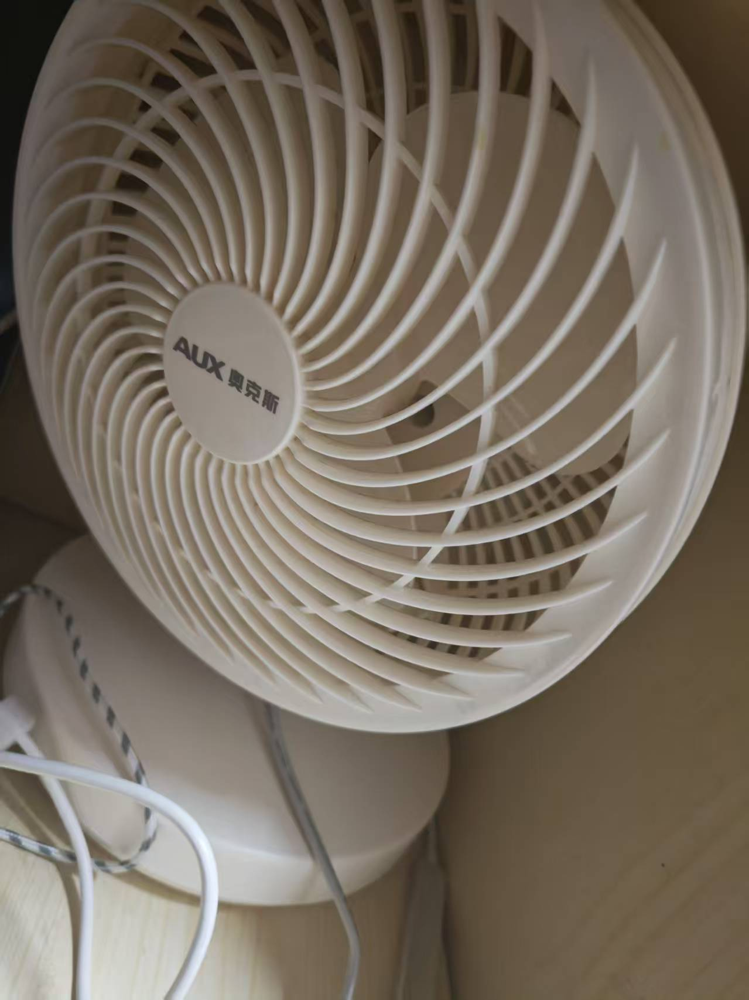
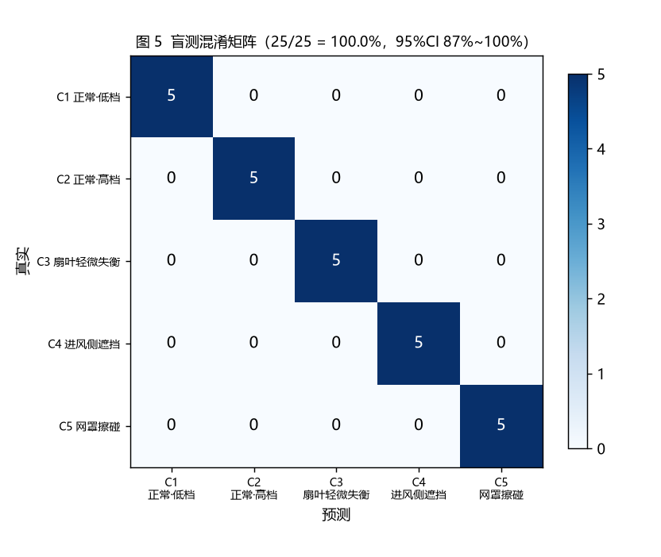

# 项目三 · 手机声振诊断仪 AC-VibDiag

> 第二阶段工坊开放式项目挑战 · 8 选 1 · 60 分
> **选题**：基于手机内置传感器的日常旋转机械/电器异常声振诊断仪
> **状态**：已完成首轮（75 段真实录音 / 全流程可复现）

| 项 | 内容 |
| --- | --- |
| 姓名 | lsj |
| 学号后四位 | 0142 |
| 学院 / 年级 | 信息与通信学院 2026 级 |
| 被测设备 | AUX 奥克斯 180 mm 台扇（220 V~ / 50 Hz / 20 W） |
| 采集通道 | 手机麦克风 · 16 kHz / 16-bit / 单声道 |
| 数据规模 | 5 工况 × 15 组 = 75 段 × 3.0 s，合计 225 s |
| 技术栈 | Python 3.10+ · 纯 numpy（无 scipy / sklearn / librosa）· matplotlib 仅用于出图 |
| 代码量 | 核心库 10 个模块（1564 行）+ 入口 565 行 + 脚本 747 行 = 2876 行（含中文注释） |

---

## 一、这个项目做了什么

拿一台普通的台扇，用手机录下它在 **5 种工况**下的声音，然后回答四个逐层加深的问题：

| 层次 | 问题 | 答案 |
| --- | --- | --- |
| ① 测量 | 频谱里能读出什么机械参数？ | **5 叶、低档 1199 r/min、高档约 2170 r/min**（从 BPF 次谐波反推，见 REPORT §3） |
| ② 分类 | 5 个已知工况能不能分开？ | 留出 25 段盲测 **25/25 = 100%**（95%CI 86.7%~100%） |
| ③ 边界 | 换个条件还准吗？ | 增益 −12 dB → 含电平特征掉到 **60%**；白噪 10 dB → **25 段全判成"擦碰"**，且错的时候置信度反而升到 **1.000** |
| ④ 泛化 | 没见过的故障能不能报警？ | 只用正常样本建模，三类未见故障 **30/30 全部检出**，误报 7% |

**如果只让我说一句话：这批数据能分出 5 个已知工况，但难点不在"分类有多准"，而在"换个录音条件还准不准"。** 所以我把一半的工作量花在把它弄难上（抗噪 / 增益漂移 / 少样本 / 未见故障），而不是把 100% 再刷一遍。

完整实验记录见 [`REPORT.md`](REPORT.md)。

| 被测设备 | 盲测结果 |
| --- | --- |
|  |  |

---

## 二、交付物对照（20 + 20 + 20）

| 考核项 | 要求 | 本仓库对应位置 | 数量 |
| --- | --- | --- | --- |
| **① 20 分** | 5 种工况 × 15 组原始 WAV/CSV 序列 | [`raw_audio/`](raw_audio/) 75 段 WAV<br>[`raw_accel/`](raw_accel/) **75 段真实加速度 CSV**（400 Hz、含 g、手机刚性固定，2026-11-25 补采）<br>[`csv_series/`](csv_series/) 75 份时序 CSV（**音频降采样，非加速度**，见该目录 README） | 75 + 75 + 75 |
| | 实验照 | [`photos/`](photos/) | 8 张 |
| **② 20 分** | 时域/频域特征提取代码 | [`src/vibdiag/features.py`](src/vibdiag/features.py)（34 维，含物理含义注释）<br>[`src/vibdiag/audio.py`](src/vibdiag/audio.py)（读写/裁剪/分帧/加噪/带通）<br>[`docs/特征字典.md`](docs/特征字典.md)（逐维定义） | 34 维 |
| **③ 20 分** | 盲测准确率与抗噪报告 | [`results/blind_score.json`](results/blind_score.json) + [`figures/fig5_blind_confusion.png`](figures/fig5_blind_confusion.png)<br>[`results/noise_sweep.csv`](results/noise_sweep.csv) + [`figures/fig6_noise_robustness.png`](figures/fig6_noise_robustness.png)<br>[`REPORT.md` §5 §6](REPORT.md) | 39 组抗噪条件 |

> **两路都已补齐（11-25 更新）。** ① 麦克风 75 段 WAV + **加速度 75 段 CSV**（`raw_accel/`，2026-11-25 21:44 采）；③ 盲测视频已入库 [`demo/blind_test_replay_20261125.mp4`](demo/blind_test_replay_20261125.mp4)（29.6 s 初版，偏短，录制手册见 `docs/盲测复核与录制手册.md`）。
> **叶片数已实数：3 叶**（11-25 拆网罩确认）。由此高档 BPF = 3 × 33.3 = **99.9 Hz**，与 100 Hz 电磁分量只差 0.1 Hz，**高档的 BPF 判据不可分离**；只有低档能分开（BPF 81.6 vs 电磁 100.0）。完整缺口表见根 `README.md`。

另外附带：**运行日志** [`process_logs/`](process_logs/)（每次跑脚本追加一条真实 JSONL）、**决策树规则** [`results/rules.txt`](results/rules.txt)（可移植成单片机 if-else）、**AI 排障记录** [`../03-AI-Collaboration/log-20261124-acoustic-vibdiag.md`](../03-AI-Collaboration/log-20261124-acoustic-vibdiag.md)、**三次实质迭代** [`iterations/`](iterations/)、**盲测复核与录制手册** [`docs/盲测复核与录制手册.md`](docs/盲测复核与录制手册.md)、**加速度通道补采方案** [`docs/加速度通道补采方案.md`](docs/加速度通道补采方案.md)（配套 `scripts/import_accel.py` / `scripts/accel_check.py`，已用 75 段真实数据跑通）、**采集前预注册** [`docs/加速度通道预期与判据预注册.md`](docs/加速度通道预期与判据预注册.md)（预期写于采前，阈值未事后调整）。

---

## 三、快速开始

```bash
cd 02-20Days-Challenge
python -m pip install -r requirements.txt   # 只有 numpy + matplotlib

python run.py all      # 全流程：体检→特征→训练→盲测→抗噪→置信度→压力测试→CSV→图
```

也可以分步跑，每条命令都会打印它做了什么、花了多少毫秒：

```bash
python run.py index             # 清点 75 段录音
python run.py features          # 34 维特征表
python run.py train             # 交叉验证 + 训练 + 导出决策树规则
python run.py blind seal        # 匿名化 25 段留出样本（答案键记 sha256 后封存）
python run.py blind predict     # 预测（全程不接触标签）
python run.py blind score       # 启封打分
python run.py noise             # 抗噪扫描（约 70 s）
python run.py confidence        # 判错时的置信度（约 30 s）
python run.py stress            # 四项压力测试（约 37 s）
python run.py baseline          # 规则树 vs 逻辑回归的失效对照（约 30 s）
python run.py figures           # 8 张图
```

单条录音的判定（把它当一个仪器用）：

```bash
python -c "import sys; sys.path.insert(0,'src'); from vibdiag import audio, features; \
x,sr=audio.read_wav('raw_audio/C3_imbalance_01.wav'); \
f=features.extract(audio.trim_steady(x,sr),sr); print({k:round(v,3) for k,v in f.items()})"
```

---

## 四、五项工况

| 编号 | 工况 | 中文 | 怎么做的 | 主要频谱证据 |
| --- | --- | --- | --- | --- |
| C1 | normal_low | 正常·低档 | 旋钮 1 档 | BPF 99.9 Hz，谱质心最低 |
| C2 | normal_high | 正常·高档 | 旋钮 2 档 | BPF 181.0 Hz |
| C3 | imbalance | 扇叶轻微失衡 | 一片扇叶根部贴胶带配重 | 轴频边带占比最高 |
| C4 | obstruction | 进风侧遮挡 | 纸板遮住后网罩约一半 | 100~800 Hz 抬升约 10 dB，峰均比最低（2.05） |
| C5 | rubbing | 网罩擦碰 | 前网罩与扇叶轻微接触 | 2~8 kHz 能量占比 0.09（其余类 0.01~0.02） |

**C2~C5 全在高档**，实测 BPF 差异 < 1.5%——这是有意的对照设计：转速钉住了，才能说四类的差别来自故障本身。

异常都是**可逆的轻故障**（胶带、纸板、手扶），不拆机、不破坏设备。详见 [`docs/工况定义与采集规范.md`](docs/工况定义与采集规范.md)。

---

## 五、它是怎么跑起来的

```
 raw_audio/*.wav (75 × 3.0 s, 16 kHz mono)
        │
        │  audio.trim_steady()   砍掉首尾各 0.5 s（首 100 ms 有淡入，见 REPORT §2.1）
        ▼
    2.0 s 稳态段
        │
        ├── 时域：RMS/峰值/峰值因子/峭度/偏度/ZCR/形状/脉冲/裕度/包络/自相关   (12 维)
        └── 频域：整段一次 FFT（0.5 Hz 分辨率，刻意不用 Welch）
              ├─ 谱形：质心/展宽/滚降/平坦度/熵/通量                      (6 维)
              ├─ 转速：BPF 主峰 + 次谐波→叶片数→r/min + 谐波比 + 轴频边带   (7 维)
              └─ 分频段：20-100 … 4000-8000 六段能量占比 + 低频/高频比      (9 维)
        ▼
     34 维特征 ──→ StandardScaler ──→ 多项逻辑回归（L2, C=0.03）
        │                              └→ 也可以用 3 层 CART（rules.txt，可移植）
        ▼
   5 类工况 + 概率 + 特征权重（能指出"凭什么判成 C3"）
```

一次特征提取约 **12 ms**（75 段共约 0.9 s），端到端可在手机端完成。

---

## 六、为什么这么选（三个会被追问的决策）

### 6.1 为什么是逻辑回归 / 决策树，不是随机森林 / CNN

75 个样本、34 维特征。**在这个规模上，复杂模型没有可验证的收益，却会毁掉可解释性。**

事实也支持这个选择：6 个不同的正则强度全部 100%，3 层决策树 4 个阈值就分完 5 类。也就是说这批数据根本不需要复杂模型——这时候选复杂模型，唯一的后果是"我说不清它凭什么判断"。

而面试第 1 维度问的就是"凭什么"。逻辑回归能直接给出 `shaft_sideband_ratio` 权重第一（失衡的指纹）、`hf_noise_ratio` 权重第七（擦碰的指纹），我能指着这两个数解释整个判据。

**但我也把两个模型放在同一组扰动下比过（REPORT §7.5）**，结论不是"逻辑回归更好"，而是**各有各的脆法**：

| 条件 | 规则树（3 特征 4 阈值） | 逻辑回归（34 维） |
| --- | --- | --- |
| 干净 | 99% | 100% |
| 增益 −6 dB | **59%（卡死）** | 81% |
| 白噪 10 dB | 68% | **20%（塌了）** |

规则树第二层就是 `rms_dbfs` 这个绝对音量阈值，增益一降全部落 C1；逻辑回归的 34 维一起平移，被整体推进 C5 的区域。**没有更稳的模型，只有稳在哪种扰动上。**

### 6.2 为什么整段一次 FFT，不用 Welch 平均

Welch 能把噪声压下去，但会把频率分辨率从 0.5 Hz 退化到几十 Hz。而 **§3.1 的叶片数推定依赖"BPF/N 那条只差 36 Hz 的次谐波"**——Welch 一上，这个判据就没了。

代价我也认：整段 FFT 的抗噪性较差，所以抗噪要靠 §6 里那套前端 + 压力测试来量化，而不是靠 Welch 掩盖。

### 6.3 为什么保留"绝对电平"特征，又专门做实验证明它有害

因为它看起来很有用（遮挡会让机器变响），实际也确实排到权重第 5。但它是**录音条件**不是**设备状态**：

| 增益偏移 | 0 dB | −6 dB | −12 dB | −18 dB | −24 dB |
| --- | --- | --- | --- | --- | --- |
| 含电平特征（34 维） | 100% | 81% | 60% | 40% | 37% |
| 去掉电平（31 维） | 100% | 100% | 100% | 100% | **100%** |

它在干净数据上带来的收益是 **0 个百分点**，代价是最多 63 个百分点。所以给出两个特征集，默认交付可解释的 34 维，但**建议部署用 31 维**（`run.py features --no-level`）。

---

## 七、结果速查

| 实验 | 结果 | 出处 |
| --- | --- | --- |
| 5 折交叉验证（75 段） | 100%（95%CI 95.1~100），macro-F1 1.000 | `results/cv_summary.json` |
| **盲测（留出 25 段，答案封存）** | **25/25 = 100%**（95%CI 86.7~100） | `results/blind_score.json` |
| 白噪 20 / 15 / 10 / 5 / 0 dB | 100% / 98% / **20%** / 20% / 20% | `results/noise_sweep.csv` |
| 粉噪 20 / 15 / 10 / 5 / 0 dB | 100% / 100% / 100% / 74% / 20% | 同上 |
| 窄带 80~3500 Hz 前端（干净） | **80%**（把 C5 的 4~8 kHz 指纹砍掉了） | 同上 |
| 宽带 80~7000 Hz 前端（干净 / 白噪10dB） | 100% / 50% | 同上 |
| 增益 −12 dB（含电平 / 去电平） | 60% / 100% | `results/stress_gain.csv` |
| 每类 1 段训练 | 97.1% ± 3.8%（最差 81.4%） | `results/stress_fewshot.csv` |
| 窗长 0.25 s → 1.5 s（15 dB 白噪） | 98.5% → 100% | `results/stress_window.csv` |
| 未见故障检出（C3/C4/C5） | 30/30 = 100%，正常误报 7% | `results/stress_novelty.json` |
| **判错时的置信度**（白噪 15 / 10 / 5 / 0 dB） | 0.375 / 0.719 / **0.998** / **1.000** | `results/confidence_by_snr.csv` |
| 规则树 vs 逻辑回归（干净 / 增益 −6 dB / 白噪 10 dB） | 99→59→68% / 100→81→20%（各有各的脆法） | `results/baseline_compare.csv` |

---

## 八、已知局限（摘要，完整版见 REPORT §8）

1. **一台设备、一个录音条件。** 型号只读到 `FC-1`，没猜；距离/角度/混响三个变量没测。
2. **"异常"是模拟的轻故障。** 胶带/纸板/手扶，与真实失效（轴承磨损、叶片裂纹、绕组故障）的频谱特征不同，不能直接迁移。
3. **指标大面积封顶。** CV/盲测/少样本/未见故障全 100%，**封顶的指标无法比较方法优劣**，也无法验证改进有没有用。要验证得有更难的数据。
4. **5 类里 C1/C2 只是档位不同，不是故障。** 真实任务其实是二分类。
5. **没做置信度校准，也没做分布外检测。** 白噪 5 dB 时错 160 条、置信度却 0.998——这样的仪表会**把错误直接用高分输出给人**。标准做法（温度缩放、OOD 分支）本项目都没做，只把现象测出来了。这是距离"真正能用"最远的一条。
6. **加速度计声道未采集。** 本轮只有麦克风。代码已把声道抽象掉（`features.extract` 只要求一维序列 + 采样率），补采后可复用全流程，但**没采就是没采**。补采方案见 [`docs/加速度通道补采方案.md`](docs/加速度通道补采方案.md)：先算清 200 Hz 采样下高档 BPF(181 Hz) 落在奈奎斯特之外、4–8 kHz 擦碰指纹物理不可见，再谈采什么。
7. ~~**叶片数是声学推定（N=5），没有拆开实物核对。**~~ **11-25 更正：实物为 3 叶，原推定错误。** 错因是先把 99.9 Hz 当成 BPF，再用 BPF/5=20.0 Hz 处的谱线反证 N=5；而惰转实验已证明 99.9 Hz 是 2× 电源电磁分量。详见 `REPORT.md` §3.1 的更正框。

---

## 九、目录结构

```
02-20Days-Challenge/
├── README.md                     # 本文件：项目概述与交付对照
├── REPORT.md                     # ★ 完整实验报告（10 节 + 全部数字出处）
├── requirements.txt
├── run.py                        # ★ 命令行入口（11 个子命令）
├── sample_index.csv              # 75 段录音清单（时长/采样率/RMS/哈希）
├── raw_audio/                    # ★ 75 段原始 WAV（5 工况 × 15 组）
├── csv_series/                   # ★ 75 份时序 CSV（同上的 1 kHz 有损视图）
├── photos/                       # ★ 8 张现场/设备照片
├── src/vibdiag/                  # ★ 核心库（纯 numpy）
│   ├── audio.py                  #   读写 / 裁剪 / 分帧 / 加噪 / FFT 带通
│   ├── features.py               # ★ 34 维时域+频域特征（唯一对外契约 FEATURE_ORDER）
│   ├── derivations.py            #   叶片数推定 / 转速换算 / 谐波衰减
│   ├── model.py                  #   标准化器 / 多项逻辑回归 / CART（纯 numpy）
│   ├── evaluate.py               #   混淆矩阵 / P-R-F1 / Wilson 区间
│   ├── blind.py                  # ★ 盲测协议（封存→预测→启封→校验）
│   ├── noise.py                  #   抗噪扫描（三种前端 × 两种噪声 × 6 档 SNR）
│   ├── stress.py                 #   四项压力测试
│   ├── dataset.py                #   样本清单与稳态段加载
│   └── telemetry.py              #   运行日志（JSONL + 脱敏）
├── scripts/
│   ├── make_figures.py           # 8 张图
│   ├── check_confidence.py       # 判错时的置信度（"自信地错"有多大）
│   ├── compare_baselines.py      # 规则树 vs 逻辑回归：各自脆在哪
│   └── demo_csv_channel.py       # 证明特征提取器与声道无关（吃 CSV 也能跑）
├── features/                     # 特征表（34 维 / 31 维两版）
├── models/                       # 3 个模型 JSON（blind / blind-nolevel / full）
├── results/                      # ★ 全部结果：CV / 盲测 / 抗噪 / 压力测试 / 规则
│   └── blind_clips/              #   25 段匿名化盲测音频（B01~B25）
├── figures/                      # ★ 8 张图（fig1~fig8）
├── process_logs/                 # ★ 真实运行日志（按日 JSONL）
└── docs/
    ├── 工况定义与采集规范.md
    ├── 特征字典.md
    └── 提交自查清单.md
```

---

## 十、自我约束

1. **不编数字。** 报告里每个数字都能指到 `results/` 下的具体文件（对照表见 REPORT §9）。读不全的铭牌型号写"不确定"，不填猜的。
2. **藏起来的短板会在面试现场变成更大的问题。** 所以我把"白噪声 10 dB 时 25 段全判成擦碰"、"窄带消噪让干净数据掉 20 点"、"叶片数推定错了（5→3，已更正）"、"加速度通道晚一天才补"全写在正文里，而不是塞进脚注。
3. **B 标志的那条曲线不平滑，我就不给它平滑。** 抗噪曲线没做插值，异常点照画，并明确写"我没解释清楚"（REPORT §6.6）。

---

© 2026 ICEC · 厚德 · 精技 · 善思 · 敢创
