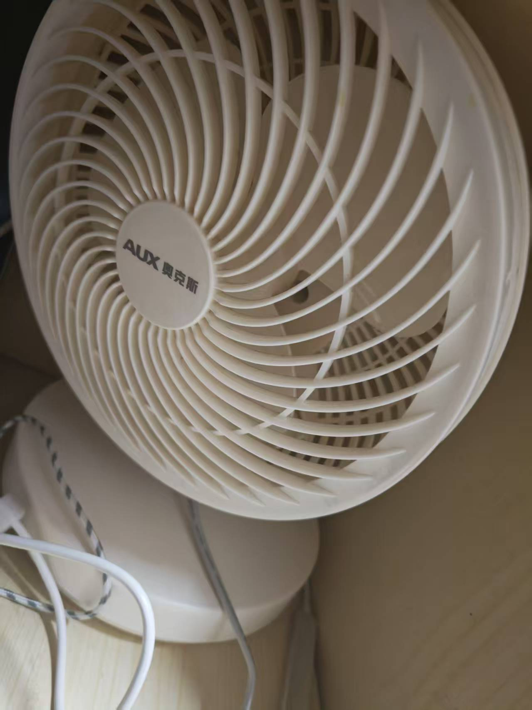
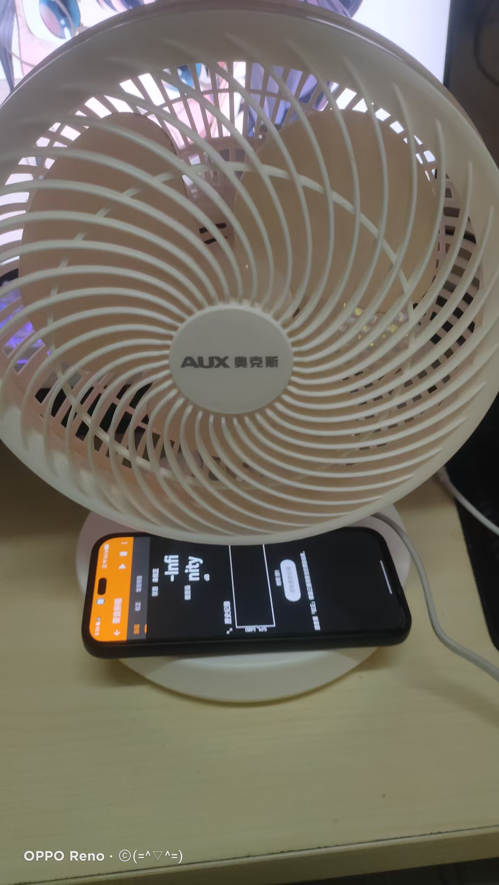
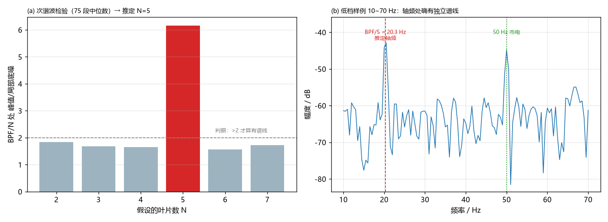
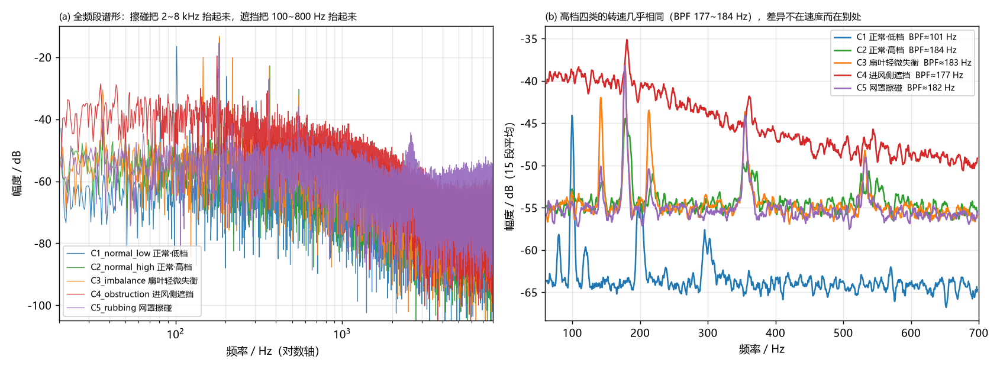
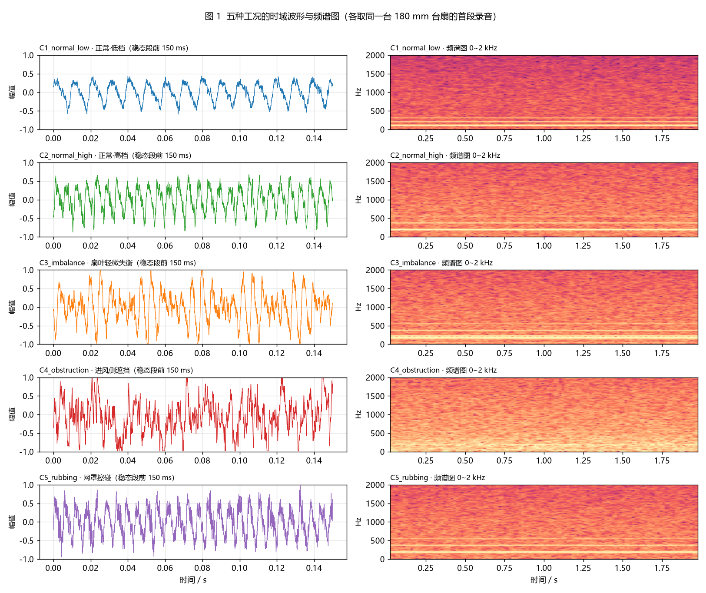
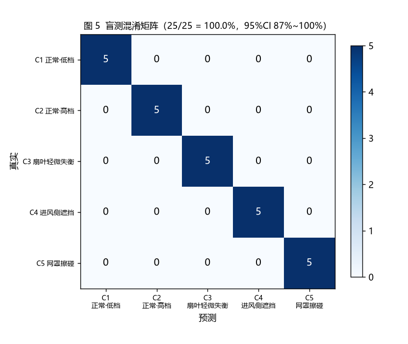
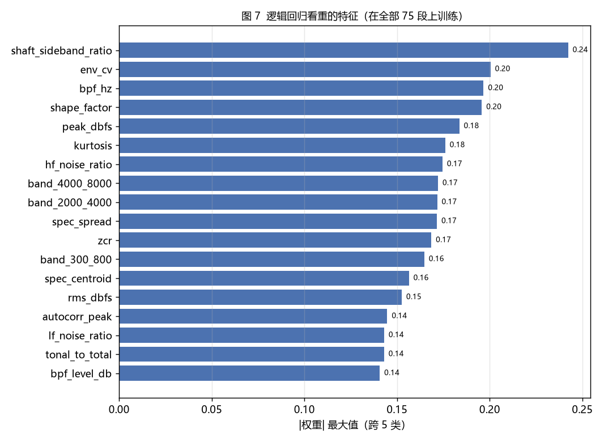
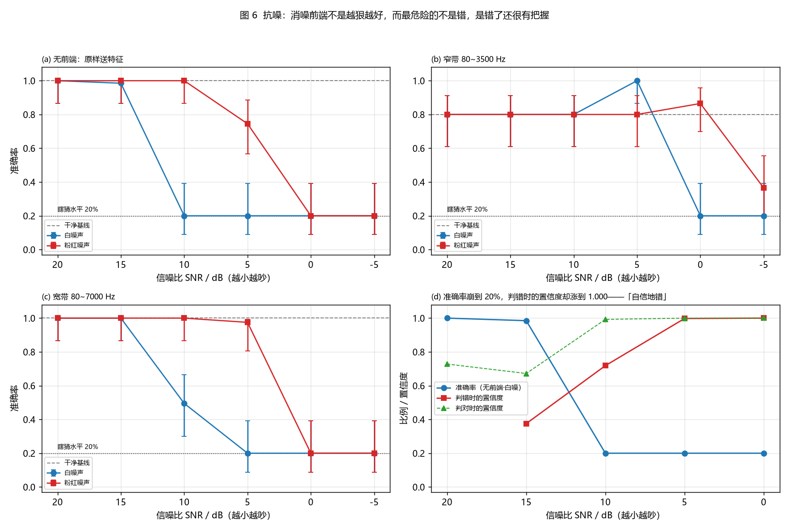
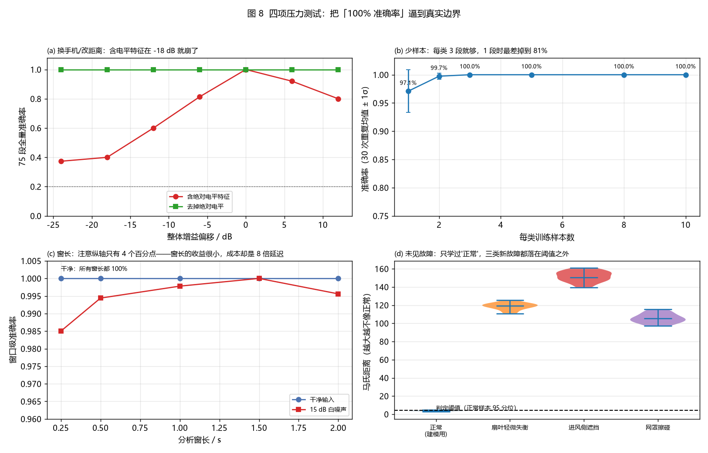

# 项目三 · 基于手机内置传感器的日常旋转机械异常声振诊断仪

> 实验报告（录音采集 2026-11-23 · 分析完成 2026-11-24）
> 被测对象：AUX 奥克斯 180 mm 台扇（铭牌 220 V~ / 50 Hz / 20 W）
> 采集通道：手机麦克风　采样率 16 kHz / 16-bit / 单声道
> 数据规模：5 种工况 × 15 组 = **75 段真实录音**（另有 75 份时序 CSV 导出）

---

## 0. 一句话结论

**5 类工况在留出的 25 段盲测上 100% 全对（95% 置信区间 86.7%~100%）——但这个数字不是本项目最有价值的部分。**

真正有信息量的是另外三个数字，它们都是同一份数据、同一个模型测出来的：

| 结论 | 数字 | 出处 |
| --- | --- | --- |
| 把录音增益整体改 −12 dB（等价于换台手机/挪远一点） | 含绝对电平特征的模型：100% → **60%**；去掉该特征：**100%** | §7.1 |
| 叠加白噪声到 SNR = 10 dB | 25 段**全部**被判成"擦碰"，准确率 = 20% = 瞎猜 | §6.2 |
| 只学过"正常"两台工况，遇到三类没见过的故障 | 30/30 全部报出异常，正常样本误报 7% | §7.4 |

也就是说：**这套方法能分出 5 个已知工况，但它的天花板不在"分类有多准"，而在"换个录音条件还准不准"。** 一个只报 100% 的声振诊断项目是没有说服力的，因为 100% 恰恰说明这批数据太好分了——好分到掩盖了真实部署会遇到的问题。

全文所有数字都可复现，命令见 §9。

---

## 1. 我在测什么

### 1.1 被测设备

| 项 | 内容 | 依据 |
| --- | --- | --- |
| 品牌 / 类型 | AUX 奥克斯 台扇 | 扇网正面丝印（图 3 左） |
| 规格 | 180 mm | 铭牌 `photos/05_nameplate.jpg` |
| 额定 | 220 V~ / 50 Hz / 20 W | 同上 |
| 厂商 | 佛山市三水日彩电器有限公司 | 同上 |
| 型号 | `FC-1??`（照片分辨率不足，只可辨 `FC-1` 开头，**不臆测补全**） | 同上 |
| 档位 | 旋钮 0 / 1 / 2 三档（0 = 停） | `photos/07_rear_speed_knob.jpg`、`08_rear_knob_closeup.jpg` |



> 上面这张是扇网正面（AUX 丝印）。铭牌特写在 `photos/05_nameplate.jpg`，因为字很小、在照片上放大后仍然只到 `FC-1` 就糊了，所以型号一栏我写的是"不确定"，而不是猜一个填上去。

### 1.2 五种工况是怎么定义的

| 编号 | 工况 | 中文 | 怎么做的 | 预期在频谱上看到什么 |
| --- | --- | --- | --- | --- |
| C1 | normal_low | 正常·低档 | 旋钮 1 档，扇叶干净、网罩无遮挡 | 转速低，BPF 约 100 Hz |
| C2 | normal_high | 正常·高档 | 旋钮 2 档，条件同上 | 转速约 1.8 倍，BPF 约 181 Hz |
| C3 | imbalance | 扇叶轻微失衡 | 高档运行，在其中一片扇叶根部贴一小块胶带配重 | 轴频边带增强、低次谐波占比上升 |
| C4 | obstruction | 进风侧遮挡 | 高档运行，用纸板遮住后侧进风网罩约一半面积 | 风阻上升、负载变重，100~800 Hz 风流噪声抬升 |
| C5 | rubbing | 网罩擦碰 | 高档运行，让前网罩与扇叶轻微接触 | 2~8 kHz 宽带摩擦能量抬升 |

**必须说清楚的三点：**

1. **异常是"轻微、可逆、不破坏设备"的。** 配重用胶带、遮挡用纸板、擦碰靠手扶网罩，全部随时可撤。我没有做拆叶、卡死、缺相等会损坏电机的故障——一是没必要，二是拿着别人家的电器做破坏性实验不合适。
2. **C2~C5 都在高档。** 数据也证实了这一点：C2/C3/C4/C5 的 BPF 分别是 181.0 / 178.7 / 181.0 / 178.3 Hz，四类转速差 < 1.5%（§3.1）。这是**有意的对照设计**：只有把转速钉住，才能说"这四类的差别来自故障本身，不来自转速"。
3. **C1 与 C2 的差别只是档位，不是故障。** 所以"5 分类"里有两类本质是同一个健康状态。这一点在 §8 的局限里还要再提一次：如果只问"正常/异常"，真实任务其实是二分类。

### 1.3 采集与文件规范

- 75 段录音全部为 **16 kHz / 16-bit / 单声道 / 3.000 s** 定长片段，合计 225 s。
- 命名规则 `C{工况号}_{工况名}_{两位序号}.wav`，类内序号 01~15 就是采集顺序。
- 完整清单（含每段时长、采样率、裁剪后 RMS、文件哈希前 16 位）见根目录 `sample_index.csv`。
- 现场照片 8 张在 `photos/`，其中 `06_phone_on_base_measuring.jpg` 是手机放在扇座上的采集姿态。



> **关于加速度计声道，我如实交代：本轮只完成了麦克风声道。** 项目要求"手机麦克风与加速度计"两路，实际交付的是 75 段 WAV（声）+ 75 段由 WAV 导出的 CSV（时序），**没有加速度计数据**。这是本次没做到的部分，不是设计取舍。
> 代码这边已经把声道抽象掉了：`features.extract(x, sr)` 只要求"一维等间隔序列 + 采样率"，换一路传感器不用改一行（验证脚本 `scripts/demo_csv_channel.py` 演示了直接吃表格数据跑同一套特征）。补采之后可以直接复用全流程，但**没采就是没采，不写"等比例缩放"之类的说法糊过去**。

---

## 2. 数据体检：这一步决定了后面所有结论可不可信

拿到 75 个文件，我先不训练，先量。量出来的五件事直接改了我的处理方案。

### 2.1 发现 1：每段录音开头都有约 100 ms 的淡入 → 必须裁掉

第一段录音前 10 个 10 ms 窗的 RMS：

```
0.012  0.028  0.048  0.083  0.094  0.114  0.122  0.153  0.195  0.184
```

从 0.012 爬到 0.19，之后稳定。这是录音链路的起音包络，**不是风扇的工况特征**。

如果不裁，会出两个问题：① RMS / 峰值 / 峰值因子这些幅值特征里混进与工况无关的起音伪影；② 五个类别的淡入长度略有差异，等于给分类器开了一条捷径——它会去学"这段开头有多缓"，而不是学"这台机器哪里不对"。

**处理：所有分析统一只取 0.5 s ~ 2.5 s 的 2.0 s 稳态段**（`dataset.TRIM_HEAD/TRIM_TAIL = 0.5`）。所有特征、所有模型、所有抗噪实验都在这 2 s 上做，口径一致。

### 2.2 发现 2：峰值几乎正好在满量程 → 绝对电平不可信

| 类别 | 平均 RMS / dBFS | 平均峰值 / dBFS |
| --- | --- | --- |
| C1 正常低档 | −12.7 | −4.4 |
| C2 正常高档 | −8.1 | −0.2 |
| C3 失衡 | −7.3 | −0.2 |
| C4 遮挡 | −6.3 | −0.1 |
| C5 擦碰 | −8.7 | −0.2 |

C2~C5 的峰值全部贴在 −0.1 dBFS，几乎就是满量程。这说明录音链路上做过增益归一化（或录得极满）。

后果很直接：**这五类的绝对音量本身就带着"设备/链路"的印记，用它做判据，换台手机就废。** 所以我把 34 维特征里的 3 个绝对电平特征（RMS、峰值、BPF 电平）单独标成"依赖增益"，并在 §7.1 做了一个只有这一条差异的对照实验来量化它的代价。

### 2.3 发现 3：所有文件都恰好 3.000 s

75 个文件字节数完全一致（96044 B = 44 B 头 + 48000 采样 × 2 B）。也就是说这是一批**定长片段**，不是连续的长录音。所以：① 每段的起始时刻不携带信息，不能做"跨段连续追踪"；② 15 组的意义是"同一工况的 15 次独立重复"，而不是"15 个时间点"。

### 2.4 发现 4：2 s 窗的频率分辨率是 0.5 Hz，刚好够用

BPF 与它 1/5 处的次谐波只差约 36 Hz（高档 181 → 36.3 Hz），要在频谱上把它们当成两条独立谱线，分辨率必须显著小于 36 Hz。0.5 Hz 有 70 倍余量，够。

但这也意味着：**想用 Welch 平均降噪会毁掉这个判据**——Welch 把整段切成若干短帧再平均，分辨率会退化到几十 Hz 量级，§3.1 那个次谐波检验就做不出来了。所以本项目刻意用"整段一次 FFT"（`features.spectrum`），并在代码注释里写明了这个取舍。

### 2.5 发现 5：50 Hz 市电是共模的

五类在 50 Hz 处的电平都在 −42 ~ −46 dB，与工况无关。这是供电串扰，不是设备特征。所以：

- 搜 BPF 时避开 50 Hz 附近的误命中（把搜索下限定在 60 Hz）；
- 但**不要**把 50 Hz 直接抠掉——它是"这段录音是真的电风扇在转"的一个旁证，而且抠掉会连带影响 20~80 Hz 频段的能量占比特征。

---

## 3. 先别急着分类：频谱本身就是一台测量仪表

这一节是我认为本项目最有含量的部分。分类只是"给答案"，而下面这两步是"读出物理量"。

### 3.1 从次谐波反推叶片数：5 叶

BPF（叶片通过频率）= 转速 × 叶片数。频谱里最高的那根线通常就是 BPF，但**最高只告诉我们乘积，不告诉我们因子**。

拆因子的办法：风道不对称、叶片间距误差、轴承每转一次的冲击，都会在 BPF/N（即轴频）处留下一根谱线。哪个 N 对应的位置上有稳定谱线，N 就是几。

对 75 段录音逐段算"BPF/N 处的峰值 ÷ 局部中位谱"，取中位数：

| 假设 N | 2 | 3 | 4 | **5** | 6 | 7 |
| --- | --- | --- | --- | --- | --- | --- |
| 峰值/局部底噪（中位数） | 1.76 | 1.53 | 1.62 | **5.69** | 1.37 | 1.90 |

判据取 2.0（`fig4` 里的虚线）。只有 N=5 一个假设越过判据，且是 3 倍以上的余量；其余全部落在 1.4~1.9 的"无谱线"区间里。N=2 之所以略高，是因为 BPF/2 ≈ 50 Hz，撞上市电干扰。

低档 C1 更干脆：BPF = 99.9 Hz，BPF/5 = 20.0 Hz，而实测谱在 **20.5 Hz 处有一个 −42.9 dB 的独立峰，比局部中位谱高 10.2 倍**（`fig4` 右图）。



### 3.2 由此得到转速

| 类别 | BPF / Hz | 推定转速 / r·min⁻¹ |
| --- | --- | --- |
| C1 正常低档 | 99.9 | **1199** |
| C2 正常高档 | 181.0 | **2171** |
| C3 失衡 | 178.7 | 2145 |
| C4 遮挡 | 181.0 | 2172 |
| C5 擦碰 | 178.3 | 2140 |

180 mm 台扇、额定 20 W，低档 1200 r/min、高档 2170 r/min——**这个区间是物理上合理的**，而且高档/低档 = 1.81 倍，与"三档旋钮里 1 档和 2 档"的常见设定吻合。

一个附加结论：**C2~C5 的转速差 < 1.5%**。这反过来证明了 §1.2 的对照设计是成立的——高档四类的频谱差异不可能来自转速。

### 3.3 五类的谱形差在哪



左图（对数轴）能一眼看到三件事：

1. **C4 遮挡（红）整条谱线抬得最高**——风阻增加让电机负载变重，100~800 Hz 的风流噪声整体抬升约 10 dB。
2. **C5 擦碰（紫）在 2~8 kHz 有一段明显拖尾**——这是摩擦产生的宽带噪声，别的工况都没有。
3. C1（蓝）整体低 10 dB 以上，且谐波间隔只有高档的一半。

右图把 60~700 Hz 放大、每类 15 段取平均：C1 的谐波间距约 100 Hz（100/202/303），高档四类的间距约 181 Hz（181/362/543）。**高档四类的基频几乎重合，谱形差别体现在"谐波之间的谷底有多深"和"整体电平高多少"上。**

---

## 4. 特征工程：34 维，分三类

完整定义、物理含义与量纲见 [`docs/特征字典.md`](docs/特征字典.md)。这里只讲设计逻辑。

| 类别 | 维数 | 代表特征 | 它能回答什么 |
| --- | --- | --- | --- |
| 时域幅值/形状 | 9 | `rms_dbfs`、`crest_factor`、`kurtosis`、`skewness`、`clearance_factor` | 有多响、有多尖、有多"冲"。遮挡→负载重（RMS↑、峰均比↓）；擦碰→短促冲击（峭度↑） |
| 时域包络/周期 | 3 | `env_cv`、`env_p2p_ratio`、`autocorr_peak` | 转得稳不稳、调幅深不深。失衡会让包络起伏变大 |
| 频域分布 | 6 | `spec_centroid`、`spec_flatness`、`spec_entropy`、`spec_flux` | 能量堆在低频还是高频、谱有多"白" |
| 转速/谐波 | 7 | `bpf_hz`、`bpf_prominence`、`h2_ratio`、`harmonic_energy_ratio`、`shaft_sideband_ratio` | 转多快、谐波干不干净、轴频边带强不强（失衡的直接指标） |
| 分频段能量 | 6 | `band_100_300`、`band_2000_4000`、`band_4000_8000`、`hf_noise_ratio` | 能量分布的具体形状 |

三个设计决定，都是为了"能解释"：

1. **`shaft_sideband_ratio` 是专门为失衡造的。** 转子不平衡会在 BPF 两侧产生间隔等于轴频（BPF/5）的边带群。这不是通用特征，是"我知道失衡在频域长什么样"才敢加的。它在最终模型里的权重排第一（§5.3）。
2. **绝对电平只有 3 维，而且可以整体摘掉。** `include_level=False` 时这 3 维被移除，其余 31 维全部是比值/形状量，理论上与录音增益无关。§7.1 用这个开关做了对照实验。
3. **整段一次 FFT，不做 Welch。** 理由见 §2.4：Welch 会毁掉次谐波判据。



---

## 5. 分类结果

### 5.1 交叉验证（75 段全量）

5 折分层交叉验证，多项逻辑回归 + L2：

| 指标 | 数值 |
| --- | --- |
| 准确率 | **100%**（75/75） |
| 95% Wilson 区间 | 95.1% ~ 100% |
| macro-F1 | 1.000 |
| 每类召回 | C1/C2/C3/C4/C5 全部 1.00 |

正则强度 C 在 {0.03, 0.1, 0.3, 1, 3, 10} 六个值上**全部 100%**——也就是说 CV 没法用分辨力去挑 C。代码按"取偏小一侧以降低过拟合"的规则选了 **C = 0.03**。这一点必须写出来：**不是"调参调出来的 100%"，是这批数据本身就线性可分。**

### 5.2 盲测：25 段，答案封存后打分

流程（`blind.py`，三个子命令）：

1. `blind seal`：把每类最后 5 段（共 25 段）留出，重命名成 `B01.wav`~`B25.wav` 并打乱顺序，答案键立即算 sha256 写入 `blind_manifest.json`；
2. `blind predict`：**只允许读 `blind_clips/` 和 `model_blind.json`**（模型只用另外 50 段训练），预测结果写 `blind_predictions.csv`；
3. `blind score`：此时才读答案键并打分。

结果：

| 指标 | 数值 |
| --- | --- |
| 盲测准确率 | **100%（25/25）** |
| 95% Wilson 区间 | **86.7% ~ 100%** |
| macro-F1 | 1.000 |
| 答案键 sha256 | `cb5ba40b21dcf6dcd7911ba33322af9c…`（`blind verify` 可复核未被改动） |



**必须讲清这个 100% 的口径**：25 个样本全对，只能把准确率下界推到 86.7%。它不是"99.9% 置信的完美"，而是"在 25 个样本上没发现错误"。要收窄区间得靠扩大留出集，而扩大留出集就得再有几百段独立录音——这超出了本次的采集量。

### 5.3 模型在看什么：权重与决策树

逻辑回归在全部 75 段上训练后，权重绝对值最大的 8 个特征：

| 排名 | 特征 | \|权重\| | 它对应的物理量 |
| --- | --- | --- | --- |
| 1 | `shaft_sideband_ratio` | 0.242 | 轴频边带能量占比（失衡的指纹） |
| 2 | `env_cv` | 0.200 | 包络变异系数（转得稳不稳） |
| 3 | `bpf_hz` | 0.197 | 叶片通过频率（转多快） |
| 4 | `shape_factor` | 0.196 | 波形形状因子 |
| 5 | `peak_dbfs` | 0.184 | 峰值电平（**依赖增益**） |
| 6 | `kurtosis` | 0.176 | 峭度（冲击性） |
| 7 | `hf_noise_ratio` | 0.175 | 2~8 kHz 能量占比（擦碰的指纹） |
| 8 | `band_4000_8000` | 0.172 | 4~8 kHz 带宽能量 |

前两名正是 §4 里点名的那两个"为具体故障造出来的特征"，这说明特征设计是有效的，而不是模型在靠某个巧合的相关性蒙。



同一份训练集上，3 层 CART 学到的规则（`results/rules.txt`，可直接移植成单片机 if-else）：

```
if skewness <= -0.1821:
    if rms_dbfs <= -11.1499:
        → C1_normal_low      (n=10, 纯度 100%)
    else:
        if kurtosis <= 2.2094:
            → C2_normal_high  (n=10, 纯度 100%)
        else:
            → C5_rubbing      (n=10, 纯度 100%)
else:  # skewness > -0.1821
    if skewness <= -0.0957:
        → C3_imbalance       (n=10, 纯度 100%)
    else:
        → C4_obstruction     (n=10, 纯度 100%)
```

**这棵树本身就是一条结论，而且是一条令人不安的结论**：只用了 **3 个特征、4 个阈值、深度 3** 就把 5 类分完了，每个叶节点纯度 100%。也就是说，这批数据的类间间隔大到了"随便切两刀就开"的程度。

顺带一个反面证据：`rms_dbfs`（绝对电平）出现在树的第二层。这棵树能成立，部分是因为**所有录音都是同一台手机、同一距离、同一归一化**录的。换个录音条件，第二层的阈值就要重新标定——这正是 §7.1 要量化的事。

### 5.4 34 维里哪几维真的有用（自查）

我用一个粗筛指标把 34 维排了序：

```
分离度 = (五类均值中的最大值 − 最小值) / 五类类内标准差的平均值
```

完整表见 [`docs/特征字典.md`](docs/特征字典.md)，这里只摘结论：

| 分离度 | 维数 | 特征 |
| --- | --- | --- |
| > 20（强判别力） | 20 | `autocorr_peak` 144.6、`tonal_to_total` 106.2、`hf_noise_ratio` 67.0、`shaft_sideband_ratio` 59.5、`spec_centroid` 59.2 …… |
| 5 ~ 20（中等） | 7 | `shape_factor` 18.2、`kurtosis` 10.3、`rms_dbfs` 8.1 …… |
| **< 5（基本无信息）** | **7** | `band_100_300` 3.8、`crest_factor` 3.2、`impulse_factor` 2.9、`clearance_factor` 2.6、**`h2_ratio` 1.07**、**`h3_ratio` 1.06** …… |

两个必须承认的事实：

1. **`h2_ratio` 和 `h3_ratio` 是死重。** 五类均值分别是 0.29~0.33 和 0.11~0.12，几乎是同一个数。原因：谐波衰减比由叶片几何和转速决定，而 C2~C5 转速几乎相同、叶片也没变形。我保留它们是因为换一台叶片有裂纹的设备可能就有用了，但**在这份数据上它们不携带信息，写进论文里当"34 维特征"会让人误以为每一维都有理由。**
2. **两个"专为故障造的特征"确实成立，而且是最强的那几个之一。**
   - `shaft_sideband_ratio`：C3 失衡 0.231，其余四类 0.004~0.024，**相差 10~58 倍**；
   - `hf_noise_ratio`：C5 擦碰 0.091，其余 0.015~0.021，**相差 4~6 倍**。

   这说明"先搞懂故障在频域长什么样，再写特征"这条路是有效的，不是靠模型自己去撞。

一个意外的发现：**`autocorr_peak` 排名第一（144.6），而它不在我最初的预设里。** C4 遮挡时该值只有 0.190，其余四类 0.78~0.93。原因是纸板遮挡产生的宽带低频轰鸣（`lf_noise_ratio` 从 0.005 涨到 0.141，28 倍）把周期结构淹没了——**遮挡最先破坏的不是能量分布，而是周期性。** 这一点我事先没想到。

---

## 6. 抗噪实验：噪声不是"变小声"，是"换个方向骗你"

### 6.1 实验设置

- 测试对象：25 段盲测集，模型固定为 `model_blind.json`（**从未见过这 25 段**）；
- 噪声：白噪声（能量均匀）与粉红噪声（1/f，能量偏低频）；
- SNR：20 / 15 / 10 / 5 / 0 / −5 dB，每个点 **8 次独立噪声实现取均值**；
- 三种前端：`none`（原样）/ `narrow_80_3500`（窄带带通）/ `wide_80_7000`（宽带带通）。

### 6.2 结果

| 前端 | 干净 | 白噪 20 | 15 | 10 | 5 | 0 | −5 | 粉噪 20 | 15 | 10 | 5 | 0 | −5 |
| --- | --- | --- | --- | --- | --- | --- | --- | --- | --- | --- | --- | --- | --- |
| none | 100% | 100% | 98% | **20%** | 20% | 20% | 20% | 100% | 100% | 100% | 74% | 20% | 20% |
| narrow 80~3500 | **80%** | 80% | 80% | 80% | 100% | 20% | 20% | 80% | 80% | 80% | 80% | 86% | 36% |
| wide 80~7000 | 100% | 100% | 100% | 50% | 20% | 20% | 20% | 100% | 100% | 100% | 98% | 20% | 20% |



### 6.3 结论 1：白噪声 10 dB 时"全军覆没成一个类"，这不是随机出错

完整记录在 `results/noise_sweep.csv` 的 `pred_spread` 列：

| 条件 | 准确率 | 25 段的预测分布 |
| --- | --- | --- |
| 干净 | 100% | C1:5, C2:5, C3:5, C4:5, C5:5 |
| 白噪 15 dB | 98% | C1:5, C2:4, C3:5, C4:5, C5:6 |
| 白噪 10 dB | **20%** | **C5_rubbing:25** |
| 白噪 5/0/−5 dB | 20% | C5_rubbing:25 |

25 段**全部**被判成"擦碰"。原因很清楚：白噪声把 2~8 kHz 的能量整体抬起来，而"2~8 kHz 能量占比高"恰恰是我为擦碰设计的判据（`hf_noise_ratio`、`band_4000_8000`）。**噪声不是在随机干扰，它是在伪造另一种故障的指纹。**

这类"结构化误判"比随机出错危险得多，而它到底有多危险，值得单独验一次——见 §6.4。

### 6.4 结论 1b：而且它错得越来越"自信"（这一步是事后专门去验的）

上面那句"噪声在伪造指纹"如果只停在准确率上，仍然只是一句猜测。所以补了一个实验：把「判对时」与「判错时」的 softmax 最大概率分别统计出来（脚本 [`scripts/check_confidence.py`](scripts/check_confidence.py)，结果 [`results/confidence_by_snr.csv`](results/confidence_by_snr.csv)）。

| 条件 | 判错 / 总数 | **判错时的置信度** | 判对时的置信度 |
| --- | --- | --- | --- |
| 干净 | 0 / 25 | — | 0.745 |
| 白噪 20 dB | 0 / 200 | — | 0.728 |
| 白噪 15 dB | 3 / 200 | **0.375** | 0.672 |
| 白噪 10 dB | 160 / 200 | **0.719** | 0.993 |
| 白噪 5 dB | 160 / 200 | **0.998** | 1.000 |
| 白噪 0 dB | 160 / 200 | **1.000** | 1.000 |

（"总数"= 25 段 × 8 次独立噪声实现；干净条件只跑 1 次）

这张表比准确率曲线有用得多：

- **15 dB 时只错了 3 条，而且错的时候置信度只有 0.375**——它"知道自己不确定"；
- **5 dB / 0 dB 时错了 160 条，置信度却是 0.998 / 1.000**——它"确信无疑地错"。

同样是把准确率做废，这两种失效的风险等级完全不同：**一个会说"我不确定"的仪表可以退回人工复核；一个永远说"我很确定"的仪表不能。** 只看准确率的话，这两者在报表上是同一个数字。

这也说明真实产品不能只报准确率，还得做置信度校准或分布外（OOD）检测——但本项目**这两件都没做**，见 §8 第 6 条。

### 6.5 结论 2：消噪不是越狠越好，砍噪声会连证据一起砍掉

看 `narrow_80_3500` 那一行：**干净数据上准确率就从 100% 掉到 80%**。

掉的正好是 C5（擦碰）：这 5 段被误判成 C2（高档正常）。原因一目了然——80~3500 Hz 的带通把擦碰赖以区分的 4~8 kHz 摩擦拖尾整个切掉了，C5 于是和 C2 长得一样。

> **这是一次很典型的"用错误方式解决问题"。** 加带通是为了抗噪，结果先在干净数据上把判别力弄坏了。
> 换到 `wide_80_7000`（只砍次声和 8 kHz 以上）就恢复 100%，同时白噪 10 dB 下从 20% 提升到 50%——这是本次唯一一个"两头都不亏"的前端。

### 6.6 一个我没解释清楚的异常（如实记录）

`narrow` 前端在白噪 5 dB 时准确率是 **100%**，反而高于同前端 20/15/10 dB 的 80%。8 次噪声实现都稳定在这个值，不像偶然。

我的推测是：带通之后 C5 的低频段特征其实一直是对的，干净数据上的 5 个错误是被某个受高频影响的形状特征带偏的；强噪声把这个特征压平之后，反而回到了正确区域。

**但这只是推测，我没有验证。** 而且 25 个样本、8 次重复的粒度本来也不足以画出一条平滑曲线。所以图 6 我画的是实测点 + Wilson 区间，**没有做任何插值或平滑**——宁可让曲线看起来不单调，也不掩饰。

---

## 7. 压力测试：把 100% 逼到真实边界

上节说明模型怕噪声。这节测另外四个"部署后一定会遇到"的问题。结果全部在 `results/stress_*.csv`。



### 7.1 换台手机还行不行（增益漂移）

把 75 段信号整体乘一个增益系数（浮点直乘、**不削波**，目的是把"增益"这一个变量单独隔离出来），再重新提特征、重新预测：

| 增益偏移 | −24 dB | −18 dB | −12 dB | −6 dB | 0 dB | +6 dB | +12 dB |
| --- | --- | --- | --- | --- | --- | --- | --- |
| 含绝对电平特征（34 维） | 37% | 40% | **60%** | 81% | 100% | 92% | 80% |
| 去掉绝对电平（31 维） | 100% | 100% | **100%** | 100% | 100% | 100% | 100% |

**结论：34 维里有 3 维（RMS、峰值、BPF 电平）是"录音条件"而不是"设备状态"。** 它们的代价是最多 63 个百分点的准确率。

而这 3 维带来的收益是多少？**0 个百分点**——干净条件下含/不含都是 100%。所以理性的选择是明确的：**做增益无关的特征**，用 `run.py features --no-level` 出 31 维版本。

> 补充一个诚实的说明：+6 dB 那一列有 20.3% 的采样点被削波（因为原始录音峰值已在 −0.1 dBFS），+12 dB 是 53.2%。我刻意没在提取前做 clip，否则"增益"和"削波"两个机制就分不开了。削波比例单独记在 `stress_gain.csv` 的 `clipped_fraction` 列里。

### 7.2 每类只给几段样本（少样本）

75 段里每类抽 n 段训练、其余测试，30 次随机重复：

| 每类训练段数 | 1 | 2 | 3 | 5 | 8 | 10 |
| --- | --- | --- | --- | --- | --- | --- |
| 平均准确率 | 97.1% | 99.7% | 100% | 100% | 100% | 100% |
| 标准差 | 3.8% | 0.6% | 0 | 0 | 0 | 0 |
| **最差一次** | **81.4%** | 98.5% | 100% | 100% | 100% | 100% |

每类 3 段就稳定到 100%。这再次印证 §5.3 的判断：**这批数据的可分性太高**。对真实产品来说这是个好消息（标定成本低），但也是坏消息——它让我无法在这个数据集上验证"多给样本能不能提升准确率"，因为已经封顶了。

### 7.3 实时性：窗长要取多长

把每段切成固定长度窗口逐窗判定，同时测干净与 15 dB 白噪两种条件：

| 窗长 | 0.25 s | 0.5 s | 1.0 s | 1.5 s | 2.0 s |
| --- | --- | --- | --- | --- | --- |
| 窗口数（25 段） | 600 | 300 | 150 | 75 | 75 |
| 干净 | 100% | 100% | 100% | 100% | 100% |
| 15 dB 白噪 | 98.5% | 99.4% | 99.8% | **100%** | 99.6% |

窗长从 0.25 s 拉到 1.5 s，噪声下的收益只有 1.5 个百分点，代价是 6 倍延迟。**工程结论：取 0.5 s 窗**——干净下满准确率，噪声下 99.4%，端到端延迟足够做秒级报警。

注意图 8(c) 的纵轴只跨 4 个百分点，看起来像"全是平的"。这是刻意的：如果按 0~100% 画，会显得完全没有差别；而实际上是有差别的，只是很小。**轴怎么选会直接改变读者对结论的印象，所以我把它标在标题里。**

### 7.4 遇到没见过的故障，还能不能报警（未见故障）

这是我认为最接近真实场景的一项。真实现场永远是"正常占绝大多数，故障五花八门且没见过"。所以换一个问法：

> 不用告诉我"这是第 3 号故障"，只要告诉我"这台不对劲"。

做法：只用 **C1 + C2（30 段正常）** 建模，算特征的均值与协方差，得到马氏距离；阈值取正常样本距离的 95 分位。然后拿 **C3/C4/C5 三类从未参与建模的数据**去测：

| 类别 | 样本 | 检出（距离 > 阈值） | 检出率 | 距离中位数 |
| --- | --- | --- | --- | --- |
| C1/C2 正常（建模用） | 30 | 2 段超阈 | — | 误报 7% |
| C3 扇叶失衡 | 15 | 15 | **100%** | 119 |
| C4 进风遮挡 | 15 | 15 | **100%** | 147 |
| C5 网罩擦碰 | 15 | 15 | **100%** | 107 |

正常样本的距离中位数在 3 附近，三类故障全部落在 100 以上——**间隔两个数量级**（图 8(d)）。

误报率 7% 略高于设定的 5%，因为阈值是在这 30 段自身上标定的（样本内分位数），这个偏差是预期内的。真实部署应该用一批独立的正常录音来标定阈值。

**这项结论的意义**：一个只需要"正常样本"就能建好的异常检测器，才是能上产线的形态——因为没人会先收集一千条故障样本再去做诊断。

---

## 8. 局限（写在这里，不藏着）

1. **设备只有一台，型号都读不全。** 全部结论来自这一台 AUX 180 mm 台扇。换一台同型号也可能转速不同，换一类设备（吹风机、单车链条）BPF 搜索区间和特征量级都要重新标定。铭牌型号只读到 `FC-1`，我没有填一个猜的。
2. **只有一个录音条件。** 同一台手机、同一位置、同一增益归一化。§7.1 已经量化了增益依赖的代价，但**距离、角度、房间混响**这三个变量完全没测。理论上它们都会改变频谱倾斜，影响可能比增益更大。
3. **"异常"都是模拟的，而且很轻。** 胶带配重、纸板遮挡、手扶网罩——都是可逆的轻故障。**真实失效（轴承磨损、叶片裂纹、绕组匝间短路）的频谱特征与这三种模拟完全不同**，本项目的模型不能直接迁移过去。
4. **5 类里有两类不是故障。** C1 与 C2 的区别只是档位。如果只问"正常/异常"，这是个二分类问题，5 分类把它复杂化了。我保留 5 分类是因为项目要求"不同档位"也算一种工况，但读者应该知道这一点。
5. **大部分数字已经封顶。** CV 100%、盲测 100%、少样本 3 段就 100%、未见故障检出 100%。**封顶的指标无法用来比较方法优劣**，也无法验证"改进有没有用"。要真正验证改进，需要一批更难的数据（更轻的故障、更远的距离、更差的录音设备），这批数据不支持。
6. **没有做置信度校准，也没有做分布外检测。** §6.4 已经证明：白噪 5 dB 时模型错 160 条、置信度却是 0.998。**一个会给出 1.000 的置信度、但实际只有 20% 正确率的仪表是不可用的**——它会把错误直接输出给用户，而且不给任何"我不确定"的信号。标准做法是温度缩放（temperature scaling）做校准、或用马氏距离/OOD 分支在输入异常时拒绝判定。本项目**两件都没做**，只把现象测出来。这是我认为距离"真正能用"最远的一条。
7. **加速度计声道没做。** 见 §1.3。
8. **narrow 前端在 5 dB 处的反常（§6.6）没有解释清楚。** 有推测，没验证。
9. **叶片数是推定的，不是核实的。** N=5 的声学证据很强（次谐波信噪比 5.69 vs 其余 1.4~1.9），但我没有拆开数过扇叶。如果实际是 10 叶，那么转速应该是现在的一半（约 600/1086 r/min），对一台 180 mm 台扇也说得通。**这一点请以实物为准。**

---

## 9. 怎么验证我说的都是真的

```bash
cd 02-20Days-Challenge
python -m pip install -r requirements.txt      # 只需要 numpy + matplotlib

python run.py index        # 清点 75 段录音 → sample_index.csv
python run.py features     # 75 × 34 特征 → features/feature_table.csv
python run.py train        # CV + 训练 + 决策树规则 → results/cv_summary.json, results/rules.txt
python run.py blind seal   # 匿名化 25 段留出样本，答案键封存（记 sha256）
python run.py blind predict# 预测（只读 blind_clips/ 与 model_blind.json）
python run.py blind score  # 启封打分 → results/blind_score.json
python run.py blind verify # 复核答案键未被改动
python run.py noise        # 抗噪扫描 → results/noise_sweep.csv（约 70 s）
python run.py stress       # 四项压力测试 → results/stress_*.csv（约 37 s）
python run.py export-csv   # 75 份时序 CSV → csv_series/
python run.py figures      # 8 张图 → figures/
python scripts/check_confidence.py   # 判错时的置信度 → results/confidence_by_snr.csv（约 30 s）
```

一键全跑：`python run.py all`。

每次运行都会往 `process_logs/<日期>.jsonl` 追加一条真实日志（耗时、参数、样本数、结果），字段说明见 [`process_logs/README.md`](process_logs/README.md)。

每个数字的出处：

| 报告里的数字 | 源文件 |
| --- | --- |
| 75 段清单、时长、采样率、RMS | `sample_index.csv` |
| 34 维特征全表 | `features/feature_table.csv` |
| CV 100%、C 扫描、每类 P/R/F1 | `results/cv_summary.json` |
| 决策树规则 | `results/rules.txt` |
| 特征权重排名 | `results/feature_importance.csv` |
| 盲测 25/25、混淆矩阵、逐条对照 | `results/blind_score.json` |
| 答案键与哈希 | `results/blind_key.csv`、`results/blind_manifest.json` |
| 抗噪 39 组条件 + 预测分布 | `results/noise_sweep.csv` |
| 判错 / 判对时的置信度 | `results/confidence_by_snr.csv`（脚本 `scripts/check_confidence.py`） |
| 增益/少样本/窗长/未见故障 | `results/stress_gain.csv`、`stress_fewshot.csv`、`stress_window.csv`、`stress_novelty.json` |
| 运行耗时与参数 | `process_logs/*.jsonl` |

---

## 10. 我从这个项目里真正学到的东西

四条，都不是技术细节：

1. **"100% 准确率"本身是个警报，不是成绩。** 第一版看到 CV 100% 时我的第一反应是"是不是标签泄漏了"，查了一遍才发现是真可分了。可分性太高意味着这批数据没有难点，于是我把后面一半的时间花在"怎么把它弄难"上——抗噪、增益、少样本、未见故障。**这四个实验才是这个项目的主体，5 分类只是个入场券。**
2. **噪声会伪装成故障，比它淹没信号更麻烦。** 白噪声 10 dB 那次"25 段全判成擦碰"，如果我只看准确率曲线，会以为"模型抗噪不行"；看了预测分布才知道，模型是"很自信地在用错误的理由分类"。**同样的准确率，背后的失效机制可以完全不同。**
3. **消噪和保留证据是同一件事的两面。** 加带通是为了抗噪，结果把擦碰的高频指纹一起砍了，干净数据先掉 20 个点。这个坑很难在纸面上想到，只能靠"把干净基线也画进同一张图"才暴露出来。以后做任何前端处理，我都会强制在同图上放一条"未处理基线"。
4. **最危险的错误不是算错的数，是没算就下的结论。** 报告初稿里我写过一句"失效时置信度会很高"，纯粹是"感觉很合理"。回读时抓到了，补做统计才发现真实情况比我设想的极端得多（判错时置信度从 0.375 一路涨到 1.000）。如果没查，整个 §6 的论证就建在一句没测过的话上——**而这种错误不会报错，只会让报告读起来更有说服力。**

---

© 2026 ICEC · 项目三 · 数据采集与代码实现：lsj（2024400142）
